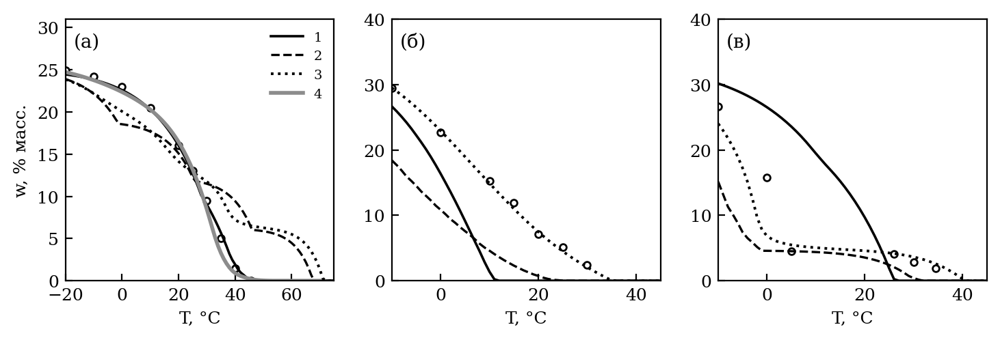
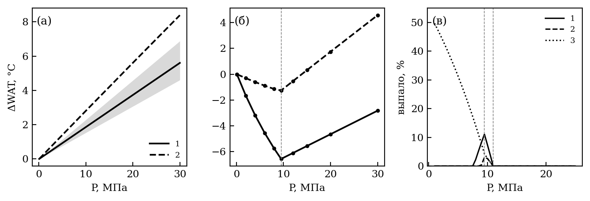
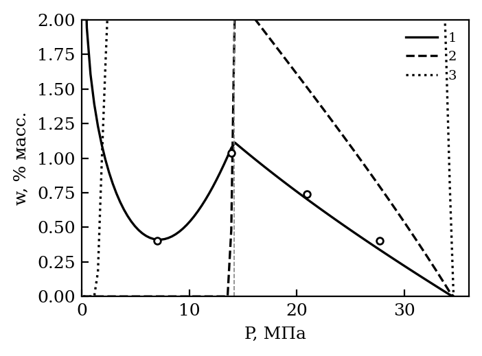
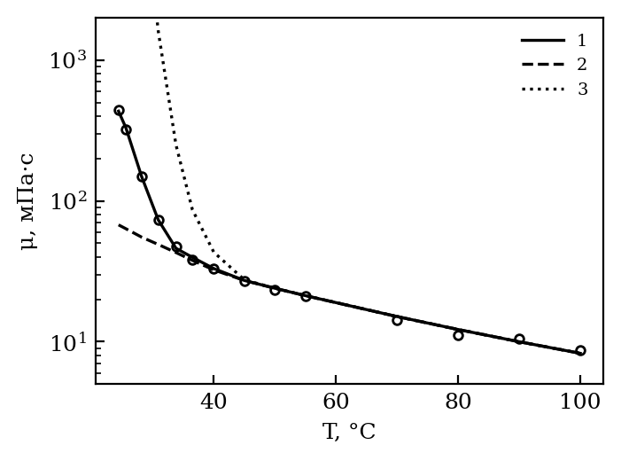
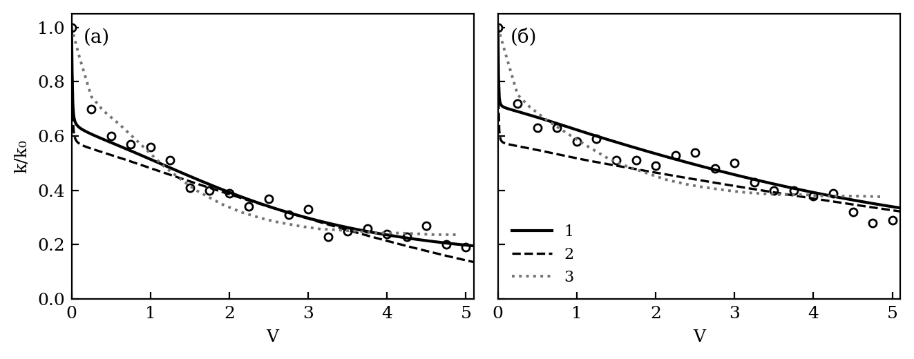
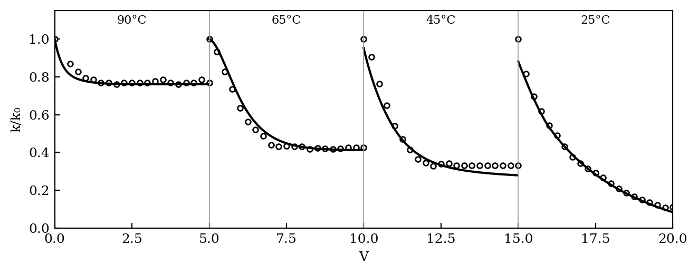
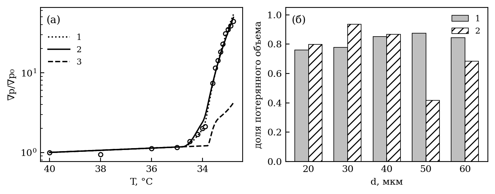
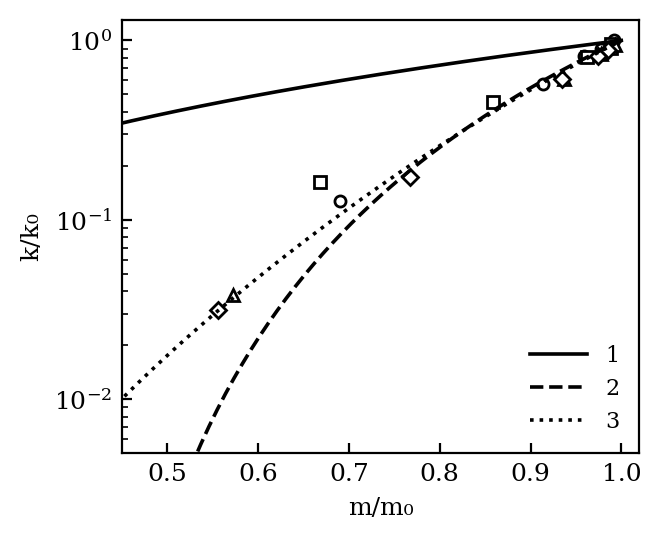
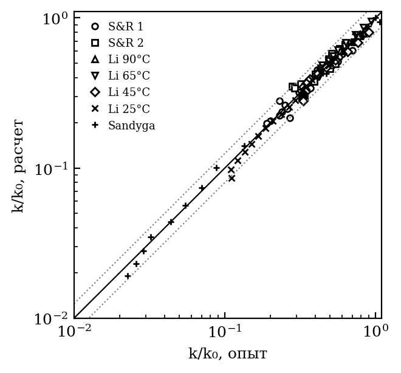

*УДК 532.546:536.42*

# КРИСТАЛЛИЗАЦИЯ ПАРАФИНОВ И ОСАЖДЕНИЕ АСФАЛЬТОСМОЛОПАРАФИНОВЫХ ВЕЩЕСТВ В ПОРИСТОЙ СРЕДЕ: МОДЕЛЬ С ДЕТАЛЬНЫМ СОСТАВОМ НЕФТИ И СИСТЕМАТИЧЕСКОЕ СОПОСТАВЛЕНИЕ С ЭКСПЕРИМЕНТАМИ

**А.И. Никифоров, И.С. Лазарев**

*Институт механики и машиностроения — обособленное структурное подразделение Федерального государственного бюджетного учреждения науки «Федеральный исследовательский центр «Казанский научный центр Российской академии наук», г. Казань, 420111, Россия*

*E-mail: Lazarevigor1234@yandex.ru*

Построена модель кристаллизации парафинов и осаждения асфальтосмолопарафиновых веществ при неизотермической фильтрации нефти с детальным составом — четырьмя группами н-алканов, асфальтенами и смолами. Модель учитывает кинетику кристаллизации в объеме нефти и на стенках пор, перенос кристаллов к стенкам и блокирование горл, вынос отложений, удержание смол и асфальтенов породой и гелеобразование. Она систематически сопоставлена со всеми доступными экспериментами: четырьмя сериями керновых опытов, парами пористость — проницаемость после отложения парафина и асфальтенов, опытом закачки холодной воды при остаточной нефти и независимыми измерениями равновесия и реологии нефти. Для каждого опыта указаны подбираемые параметры и метрики расхождения. С набором параметров на каждый опыт керны описываются со среднеквадратичным отклонением проницаемости {{B_OWN_MIN}}–{{B_OWN_MAX}}. Один набор из восьми параметров на все керны вместо пятнадцати дает {{B_UNI_MIN}}–{{B_UNI_MAX}}, причем от системы зависят только неизмеренная вязкость нефти и константа кристаллизации в объеме. Общим набором не описывается лишь ступень 25°C опыта с нефтью Жетыбая. В совместной калибровке пересыщение в пористой среде снимается в основном кристаллизацией на стенках пор, а вынос отложений не требуется. Гипотеза о затрудненной диффузии кристаллов в гелированной нефти проверена и отвергнута. Сеть пор и горл описывает связь проницаемости с пористостью лучше пучка капилляров, но при блокировании горл кристаллами закупоривает керн раньше, чем в опыте.

**Ключевые слова:** парафин, асфальтены, кристаллизация, осаждение в пористой среде, повреждение пласта, керновые эксперименты, калибровка модели

# ВВЕДЕНИЕ

Асфальтосмолопарафиновые отложения (АСПО) образуются в пласте, когда нефть охлаждается ниже температуры начала кристаллизации парафина (WAT) или когда меняются давление и состав, от которых зависит растворимость асфальтенов [1]. Твердая фаза оседает на стенках пор, закупоривает поровые каналы и делает нефть вязкопластичной, а смолы и асфальтены удерживаются породой и без выпадения в отдельную фазу [3]. Для прогноза такого повреждения пласта нужна модель, которая связывает термодинамику выпадения с переносом твердой фазы к стенкам пор и с изменением проницаемости.

Механизмы отложения парафина сформулированы для трубопроводов: молекулярная диффузия растворенного парафина к холодной стенке, сдвиговая дисперсия, броуновская диффузия и гравитационное оседание кристаллов [50]. В пласте стенка пор имеет температуру нефти, поэтому радиального градиента температуры, на котором держится молекулярная диффузия в трубе, нет. Пересыщенный раствор снимается кристаллизацией — в объеме нефти и на поверхности пор, — а уже выпавшие кристаллы переносятся к стенкам диффузией и потоком. Отложения уплотняются со временем [51] и срываются потоком при касательном напряжении выше их прочности [52]. Модели осаждения парафина в пласте [9–11] учитывают эти процессы выборочно: кристаллизацию принимают равновесной, хотя в опытах с быстрым охлаждением пересыщение отстает от равновесия [12], а связь проницаемости с отложением задают степенной зависимостью [13, 53] или функцией распределения пор [15].

Сравнение таких моделей с экспериментом обычно ограничивается одним керновым опытом, по которому подбираются все коэффициенты [9, 11]. Согласие, полученное подбором на тех же данных, не говорит о том, переносятся ли параметры на другую нефть, другой керн или другой температурный режим. Термодинамическую часть при этом проверяют, как правило, только по WAT. Между тем калориметрия дает температуру появления кристаллов при охлаждении, а термодинамическая модель — температуру их исчезновения при нагреве, и вторая выше первой [38]. Поэтому модель стоит проверять и по количеству выпавшего парафина, и по независимым свойствам: сдвигу WAT с давлением, вязкости при охлаждении, синтетическим смесям известного состава [30].

В работе [54] была построена модель неизотермической фильтрации с одним псевдокомпонентом парафина и функцией распределения пор по размерам. Здесь она расширена до детального состава нефти и кинетики осаждения. Тепловая задача — теплообмен с вмещающими породами, скрытая теплота кристаллизации, тепловое неравновесие — и ее верификация рассмотрены отдельно [55]. Цель настоящей работы — описать механизмы кристаллизации и осаждения в модели и систематически сопоставить ее со всеми доступными экспериментами: керновыми опытами по повреждению пласта парафином, смолами и асфальтенами и независимыми измерениями равновесия и реологии нефти. Для каждого опыта указано, какие параметры подбираются и по каким данным, приведены метрики расхождения и разобраны их причины. Главное внимание уделено тому, переносятся ли параметры между опытами: модель калибруется одним набором параметров на все керны, а различие между системами допускается только для величин, которые зависят от нефти физически и в опыте не измерены.

# МАТЕМАТИЧЕСКАЯ МОДЕЛЬ

## Фильтрация и перенос компонентов

Течение воды и нефти считается двухфазным, неизотермическим и несжимаемым, капиллярное давление и сила тяжести не учитываются. Нефтяная фаза состоит из групп н-алканов $k = 1, \ldots, N_w$, каждая — в растворенном ($w_k^d$) и взвешенном ($w_k^s$) состоянии, растворенных и флокулированных асфальтенов, смол и остатка (изо- и циклоалканы и ароматика). Все доли массовые и относятся к фазе плотности $\rho_o$. Уравнения сохранения массы воды и каждого компонента $c$ нефти

$$\frac{\partial}{\partial t}\left(m \rho_w S_w\right) + \nabla\cdot\left(\rho_w \mathbf{U}_w\right) = q_w \rho_w, \qquad \frac{\partial}{\partial t}\left(m S_o \rho_o w_c\right) + \nabla\cdot\left(\rho_o w_c \mathbf{U}_o\right) = q_o \rho_o w_c - \rho_o s_c, \qquad (1)$$

где $m$ — пористость; $S_w$, $S_o$ — насыщенности; $\mathbf{U}_w$, $\mathbf{U}_o$ — скорости фильтрации по закону Дарси с относительными фазовыми проницаемостями Кори; $q_w$, $q_o$ — дебиты скважин; $s_c$ — сток компонента в отложения. Растворенная и взвешенная части группы движутся с нефтью с одной скоростью, поэтому (1) записывается для их суммы $w_k = w_k^d + w_k^s$. Стоки выражены через скорости потери порового объема: $q_{p1}$ — осаждение кристаллов на стенках пор, $q_{p2}$ — пробки в горлах, $q_{w}$ — кристаллизация на стенках, $q_{pa}$ — осадок флокул асфальтенов, $q_{ad}$ — удержание смол и асфальтенов. Для группы парафина

$$s_k = \frac{\rho_p}{\rho_o}\left[\left(q_{p1} + q_{p2}\right)\frac{w_k^s}{\sum_j w_j^s} + q_{w,k}\right], \qquad q_{p1} + q_{p2} + q_w + q_{pa} + q_{ad} = -\frac{\partial m}{\partial t}, \qquad (2)$$

где $\rho_p$ — плотность кристаллического парафина. Второе соотношение (2) замыкает объем отложений на изменение пористости, поэтому балансы массы каждого вещества выполняются точно.

Температура находится из уравнения энергии в однотемпературном приближении. В нем учитываются конвективный перенос, теплопроводность, скрытая теплота кристаллизации и теплообмен пласта с вмещающими породами по методу Винсома—Вестервельда; постановка и верификация тепловой части приведены в [55]. Для кернов в настоящей работе температура задается программой опыта.

## Равновесие парафина

Распределение н-алканов C17–C60 по числу атомов углерода $n$ задано законом $z_n \propto e^{-sn}$ и разбито на четыре группы (C17–22, C23–30, C31–40, C41–60); молярная масса $M_k$, температура плавления $T_{m,k}$ и калориметрическая теплота $L_k$ групп осреднены по корреляциям Вона [17]. Каждая группа выпадает в собственную чистую твердую фазу [18] с пределом растворимости

$$\ln x_k^{sat} = -\frac{\Delta H_{eff}}{R}\left(\frac{1}{T} - \frac{1}{T_{m,k}}\right) - \frac{\Delta v_k\,(P - P_{ref})}{R T}, \qquad x_k^{sat} \le 1, \qquad (3)$$

где $x_k^{sat}$ — мольная доля группы в насыщенном растворе; $\Delta v_k$ — скачок молярного объема при плавлении; $P_{ref}$ — давление, при котором измерена кривая выпадения. Реальная нефть — неидеальный растворитель, поэтому $\Delta H_{eff}$ и общий сдвиг $T_{m,k}$ относительно корреляции Вона — эффективные параметры, подобранные вместе с наклоном $s$ по кривой выпадения парафина. Раствор — все, что не выпало: растворитель молярной массы $M_o$, растворенный газ $n_g(P)$ и растворенные группы:

$$n_L = \frac{1 - \sum_k w_k}{M_o} + n_g(P) + \sum_k \frac{w_k^d}{M_k}, \qquad w_k^{d,eq} = \min\left(w_k,\ x_k^{sat}\, n_L\, M_k\right). \qquad (4)$$

Насыщение группы только уменьшает $n_L$, поэтому множество насыщенных групп набирается по убыванию порога $w_k/(M_k x_k^{sat})$ не более чем за $N_w$ шагов. При одной группе (4) переходит в модель бинарного идеального раствора [9, 10].

Для проверки эффективной модели реализован вариант без подбираемых параметров: коэффициенты летучести жидкости — по уравнению Пенга—Робинсона [31], свойства плавления — калориметрические, по Вону или с твердо-твердым переходом по Coutinho и др. [43], а твердая фаза — чистые компоненты или неидеальный твердый раствор UNIQUAC [37]. В расчете пласта этот вариант не используется (см. ниже).

## Асфальтены

Растворимость асфальтенов описывается моделью Хиршберга [20]: предельная объемная доля растворенных асфальтенов

$$\phi_a^{max} = \exp\left[\frac{v_a}{v_m} - 1 - \frac{v_a(\delta_a - \delta_m)^2}{RT}\right], \qquad (5)$$

где $v_a$, $v_m$ — мольные объемы асфальтенов и мальтенов; $\delta_a$, $\delta_m$ — их параметры растворимости. Параметр мальтенов смешивается по долям SARA-фракций и растворенного газа, поэтому растворимость минимальна у давления насыщения. Параметр $\delta_a$ находится из условия, что при давлении начала осаждения и пластовой температуре начальная доля асфальтенов насыщающая. Избыток переходит во флокулы с конечной скоростью. В варианте на уравнении состояния асфальтены описываются моделью твердой фазы Нгхайема [33].

## Кинетика кристаллизации

Равновесная взвесь $w_{s,k}^{eq} = w_k - w_k^{d,eq}$ из (4) достигается с конечной скоростью [12]. Пересыщение $\Delta_k = w_{s,k}^{eq} - w_{s,k}$ снимается двумя параллельными путями первого порядка — ростом кристаллов в объеме нефти с константой $k_{cr}$ и кристаллизацией на стенках пор с константой $k_{wall}$:

$$\frac{d w_{s,k}}{dt} = k_{cr}\,\Delta_k, \qquad \Delta_k^{wall} = \frac{k_{wall}}{k_{wall} + k_{cr}}\left(1 - e^{-(k_{wall} + k_{cr})\Delta t}\right)\Delta_k, \qquad (6)$$

где $\Delta_k^{wall}$ — часть пересыщения, кристаллизующаяся на стенках за шаг $\Delta t$; ей отвечает скорость потери порового объема $q_{w,k}$ в (2). Кристаллизация на стенках сужает все проводящие каналы одинаково, со скоростью $\upsilon_w = -q_w/a$, где $a$ — удельная поверхность каналов. Равновесной кристаллизации отвечают $k_{cr} \to \infty$, $k_{wall} = 0$.

## Перенос кристаллов к стенкам, блокирование и вынос

Поровое пространство представлено пучком цилиндрических капилляров с горлами [15, 21]: отношение радиуса горла к радиусу канала $\gamma$ одинаково для всех капилляров, кристаллы — шары диаметра $d_p$, капилляр блокируется, если кристалл не проходит горло, а доля капилляров, занятых нефтью, пропорциональна ее насыщенности. Скорость сужения канала радиуса $r$ взвешенными кристаллами следует из решения Левека для массопереноса в канале, скорость блокирования — из частоты подхода кристаллов к горлу [21]:

$$\upsilon_r = -w_s S_o^*\left(\frac{2 u_m D_p^2}{r L_k}\right)^{1/3} + \upsilon_w + \upsilon_e, \qquad \upsilon_b = \begin{cases} S_o^*\dfrac{6\beta r^2 w_s u_m\varphi}{d_p^3}, & r \le d_p/(2\gamma),\\[2mm] 0, & r > d_p/(2\gamma), \end{cases} \qquad (7)$$

$$u_m = \frac{|\nabla P|\, r^2}{8\eta\mu_p}, \qquad D_p = \frac{k_B T}{3\pi\mu_D d_p}, \qquad (8)$$

где $w_s = \sum_k w_k^s$; $S_o^*$ — подвижная нефтенасыщенность; $L_k$ — длина порового канала; $\beta$ — доля блокируемых каналов; $u_m$ — средняя скорость нефти в канале; $\eta$ — извилистость; $\mu_p$ — вязкость нефти с кристаллами; $D_p$ — коэффициент броуновской диффузии кристалла по Стоксу—Эйнштейну; $k_B$ — постоянная Больцмана; $\varphi$ — функция распределения каналов по радиусам (см. (13)). Вязкость $\mu_D$ в (8) — вязкость жидкости, в которой движется кристалл, то есть нефти с кристаллами $\mu_p$. Флокулы асфальтенов оседают по тем же формулам со своим диаметром.

Кинетика (7) при броуновской диффузии быстрее переноса взвеси, и за шаг из нефти могло бы выпасть больше кристаллов, чем в ней есть. Поэтому скорости ограничены подводом: за шаг оседает не больше взвеси, чем останется в ячейке после оттока нефти через грани и скважину.

Отложение толщиной $h$ срывается потоком, когда касательное напряжение на стенке канала $\tau_w = r|\nabla P|/(2\eta)$ превышает прочность отложения $\tau_{cr}$ [52]:

$$\upsilon_e = k_e\left(\frac{\tau_w}{\tau_{cr}} - 1\right) h \quad \text{при } \tau_w > \tau_{cr}, \qquad \upsilon_e = 0 \quad \text{иначе}, \qquad (9)$$

где $k_e$ — константа скорости выноса. Порог $\tau_{cr}$ отвечает пределу текучести гель-отложения парафина и нефти [51].

## Удержание смол и асфальтенов

Растворенные асфальтены и смолы удерживаются породой — адсорбируются и задерживаются в горлах — по кинетической изотерме Ленгмюра с константой равновесия, зависящей от температуры по Вант-Гоффу:

$$\frac{d\Gamma}{dt} = k_{ads}\left(\Gamma_{eq} - \Gamma\right), \qquad \Gamma_{eq} = \Gamma_{max}\frac{K c}{1 + K c}, \qquad K = K_{ref}\exp\left[-\frac{\Delta H_{ads}}{R}\left(\frac{1}{T} - \frac{1}{T_{ref}}\right)\right], \qquad (10)$$

где $\Gamma$ — удержанная масса на единицу объема породы (ее прирост — сток $q_{ad}$ в (2)); $c$ — массовая доля в нефти; $\Delta H_{ads} < 0$ — эффективная энтальпия. Емкость $\Gamma_{max}$ отнесена к удельной поверхности породы, скорость массообмена $k_{ads} \propto T/\mu$ растет с температурой по Уилки—Чангу [22]. Удержанный объем $\sigma$ снижает проницаемость по функции повреждения Сивана [3]:

$$\frac{k}{k_0} = \frac{k_b}{k_0}\left(1 - \frac{\sigma}{\sigma_{max} m_0}\right), \qquad (11)$$

где $k_b$ — проницаемость порового пространства с отложениями парафина. Шаг (10) записан неявно по концентрации в нефти ячейки: при заводнении в промытой зоне остается мало нефти, и явная запись за шаг выбирала бы всю растворенную фракцию, а на следующем шаге десорбировала бы ее.

## Вязкость и гель

Вязкость нефти с кристаллами — ньютоновская часть формулы Педерсена—Рённингсена [23]: $\mu_p = \mu_L(T)\,e^{D\phi_s}$, где $\mu_L$ — вязкость жидкой основы по Аррениусу с энергией активации $E_a$, $\phi_s$ — объемная доля взвешенных кристаллов. Ниже точки гелеобразования кристаллы сцепляются в сетку, и нефть становится вязкопластичной с пределом текучести $\tau_y = \tau_{ref}\left[(\phi - \phi_{gel})/(\phi_{ref} - \phi_{gel})\right]^{n_g}$, где $\phi$ — доля твердого парафина в поровом объеме нефти вместе с осадком: осадок на стенках — это гель с захваченной нефтью. Расход бингамовской жидкости в капилляре с напряжением на стенке $\tau_w$ отличается от пуазейлевского множителем Букингема—Райнера $F(\xi) = 1 - \tfrac{4}{3}\xi + \tfrac{1}{3}\xi^4$, $\xi = \tau_y/\tau_w < 1$, и подвижность нефти умножается на

$$\Phi = \frac{\int r^4 \varphi\, F\left(\tau_y/\tau_w(r)\right) dr}{\int r^4 \varphi\, dr}, \qquad \mu_o = \frac{\mu_p}{\max(\Phi,\ \Phi_{min})}. \qquad (12)$$

Множитель $\Phi$ берется по градиенту давления прошлого шага и релаксирует к равновесному значению с тиксотропным временем $t_{gel}$. Через кажущуюся вязкость $\mu_o$ гель входит в уравнение давления, продуктивность скважин и перетоки.

## Поровое пространство

Функция распределения капилляров по радиусам $\varphi(r,t)$ с начальным логнормальным распределением Косуги [24] $\varphi_0(r) = \exp\left[-\ln^2(r/r_m)/(2\sigma_r^2)\right]/(\sqrt{2\pi}\sigma_r r)$, где $r_m$ — медианный радиус, $\sigma_r$ — стандартное отклонение $\ln r$, меняется по уравнению [21]

$$\frac{\partial \varphi}{\partial t} + \frac{\partial\left(\upsilon_r \varphi\right)}{\partial r} + \upsilon_b = 0. \qquad (13)$$

Сужение отражается переносом $\varphi$ по оси радиусов, так что канал сам переходит из режима оседания в режим блокирования. Пористость и проницаемость пучка — моменты решения (13):

$$m = m_0\frac{\int r^2 \varphi\,dr}{\int r^2 \varphi_0\,dr} + m_d, \qquad k_b = k_0\frac{\int r^4 \varphi\,dr}{\int r^4 \varphi_0\,dr}, \qquad (14)$$

где $m_d$ — тупиковая пористость: канал с пробкой выходит из проводимости, но его объем с нефтью остается в пласте. Извилистость $\eta$ в (8) выбирается так, чтобы пучок с $\varphi_0$ имел проницаемость $k_0$; тогда скорость нефти в каналах согласована со скоростью фильтрации.

В пучке проницаемость исчезает лишь при закрытии всех каналов. В сети пор и горл [16, 25] проводимость дают горла радиуса $r_t = \gamma(r + h) - h$, соединенные с координационным числом $z$, и эффективная проводимость горла $g_m$ находится по приближению эффективной среды Киркпатрика [16]:

$$\sum_i w_i\frac{g_m - g_i}{g_i + (z/2 - 1)\,g_m} + \frac{w_b}{z/2 - 1} = 0, \qquad \frac{k_b}{k_0} = \frac{g_m}{g_m^0}, \qquad (15)$$

где $w_i$ — доли открытых горл с проводимостью $g_i \propto r_t^4$, $w_b$ — доля закрытых и заблокированных. Проницаемость сети исчезает на пороге протекания $2/z$.

## Метод решения

Уравнения дискретизированы методом контрольных объемов на прямоугольной сетке с разностями против потока; давление — неявно, остальные переменные — явно (IMPES) с шагом по фактическому числу Куранта. Уравнение (13) решается неявной прогонкой по радиусам, кинетика (6), флокуляция и удержание (10) — точными экспонентами или неявно за шаг, поэтому жесткие константы шаг не ограничивают. Балансы массы групп парафина, асфальтенов и смол выполняются с точностью $10^{-16}$. Керн рассчитывается той же программой, что и пласт, на одномерной сетке.

# ЭКСПЕРИМЕНТАЛЬНЫЕ ДАННЫЕ И МЕТОДИКА СОПОСТАВЛЕНИЯ

## Опыты

Использованы все опубликованные опыты, условия которых позволяют повторить их расчетом (табл. 1). Это керновые опыты с прокачкой нефти, в которых температурный режим задан явно, пары пористость — проницаемость кернов после отложения парафина и асфальтенов, опыт с закачкой холодной воды в керн с остаточной нефтью и независимые измерения равновесия и реологии нефти.

Таблица 1. Экспериментальные данные

| Опыт | Система | Условия | Измерено |
|---|---|---|---|
| Sutton, Roberts [27] (данные — по [9, 11]) | две парафинистые нефти (4.1 и 6.1% масс. парафина, точки помутнения 37.8 и 35°C), керн Berea 405 и 314 мД | прокачка с постоянным расходом при 21.1°C, 5 поровых объемов | $k/k_0$ от объема прокачки |
| Li и др. [19] | нефть Жетыбая: парафин 24.93%, смолы 5.52%, асфальтены 0.91% масс., WAT 45.65°C; керн 18.8 мД, пористость 16.9% | ступени 90, 65, 45, 25°C по 5 поровых объемов, 0.1 мл/мин | $k/k_0$ каждой ступени; кривая выпадения парафина; вязкость при 24–100°C |
| Sandyga и др. [2] | 20% масс. парафина в керосине; керн песчаника 3 × 5 см, пористость 9%, остаточная вода | охлаждение с 40 до 32.8°C со скоростью 1°C/ч, 0.5 см³/мин | градиент давления от температуры; распределение пор до и после опыта по томографии |
| Struchkov, Rogachev [46] | 10–60% парафина в керосине | охлаждение со скоростью 0.001–0.042°C/с, давление до 40 МПа | WAT от скорости охлаждения, концентрации и давления |
| Xie и др. [28] | керны месторождения Чанчуньлин, нефть с WAT 25–26°C | изотермическая прокачка при 50–5°C | пары пористость — проницаемость (19 точек, 4 керна); проницаемость по нефти от температуры |
| Lin и др. [48], Struchkov и др. [49] | карбонат, нефть с гептаном; песчаник, живая нефть у давления начала осаждения | осаждение асфальтенов | пары пористость — проницаемость |
| Maloney, Oesthus [29] | мел 1.5 мД, остаточная нефть с точкой помутнения 25°C | закачка воды при ступенчатом охлаждении с 66 до 10°C | проницаемость по воде |
| da Silva и др. [30] | н-алканы C18–C36 в н-декане, пять смесей | атмосферное давление | температура исчезновения парафина, доля твердого |
| Tabzar и др. [34] | живая нефть, 16 псевдокомпонентов, 100°C | снижение давления | доля выпавших асфальтенов |

В опыте Sandyga и др. керн перед прокачкой раствора насыщался моделью пластовой воды, и в нем центрифугированием создавалась остаточная водонасыщенность [2]. Ее значение не приведено, поэтому керн рассчитывается однофазным. Исходный скан томографии снят на экстрагированном и высушенном образце (открытая пористость 9.0%), скан после опыта — после прокачки воды (2.1%) [2]. Объемная WAT раствора (30°C) измерена реометром при охлаждении со скоростью 1°C/мин и скорости сдвига 5 с⁻¹ [2]. Для опыта Xie и др. расход, размеры кернов и объем прокачки при каждой температуре не приведены, а «эффективная проницаемость по нефти» включает неньютоновскую вязкость. Поэтому ряд проницаемости от температуры повторить расчетом нельзя, и используются только пары пористость — проницаемость. [TODO: условия прокачки в опыте Xie и др. — запросить у авторов]

## Метрики

Для кривых $k/k_0$ используются среднеквадратичное отклонение (СКО), коэффициент детерминации $R^2 = 1 - \sum_i(k_i^{m} - k_i^{e})^2/\sum_i(k_i^{e} - \bar k^{e})^2$ и средняя относительная ошибка (MAPE) по точкам, где $k/k_0 \ge 0.05$; здесь $k_i^{m}$ и $k_i^{e}$ — расчет и опыт в точке $i$. Для опыта Sandyga и др., где градиент давления вырос в 44 раза, сравнение идет в логарифмической шкале $\lg(\nabla p/\nabla p_0)$. Собственный разброс точек опыта (шумовой порог) оценен по вторым разностям точек, а для опыта Sandyga и др. — по точности оцифровки обеих осей. Модель, проходящая к точкам ближе порога, подогнана под шум, поэтому целью служит больший из порога и 0.05 по $k/k_0$.

## Калибровка: на каждый опыт и общий набор

Термодинамика групп парафина, вязкость и предел текучести геля определены по независимым измерениям свойств нефти Жетыбая [19] — кривой выпадения парафина и вязкости при охлаждении. Параметры удержания смол и асфальтенов подобраны по ступеням 90, 65 и 45°C опыта Li и др., где парафин растворен и единственный механизм повреждения — удержание. Остальные параметры осаждения подбирались двумя способами.

В первом, как в работах [9, 11], каждому семейству опытов подбирается свой набор: диаметр кристалла $d_p$, множитель $f_D$ к коэффициенту броуновской диффузии (8) и параметры выноса (9) — по каждому опыту Sutton и Roberts; $d_p$, $f_D$ и $k_{cr}$ — по ступени 25°C опыта Li и др.; $k_{wall}$, $k_{cr}$ и WAT пористой среды — по опыту Sandyga и др. Это 15 параметров на четыре кривые, и согласие при таком подборе характеризует гибкость модели, а не ее предсказательную силу.

Во втором способе у всех кернов одна модель — одни и те же механизмы (пучок капилляров, перенос кристаллов к стенкам, кристаллизация в объеме и на стенках, вынос отложений; удержание смол и асфальтенов — там, где они есть в нефти) и один набор чисел: $d_p$, порог и скорость выноса, $k_{wall}$. Множителя $f_D$ нет, коэффициент диффузии — по Стоксу—Эйнштейну (8). Различаются только величины, которые физически зависят от системы и в опыте не измерены. Во-первых, вязкость нефтей Sutton и Roberts: у Ring и др. [9] она принята 3 мПа·с для обеих нефтей, а при заданном расходе входит только в $D_p \propto 1/\mu$, поэтому ищется в пределах 1–30 мПа·с. Во-вторых, константа кристаллизации в объеме: у нефти и у модельного раствора парафина в керосине она своя, поскольку в нефти зарождение кристаллов идет на асфальтенах и смолах [50]. Значение для раствора проверяется независимым опытом Struchkov и Rogachev [46]. Итого восемь параметров на четыре кривые. Невязки опытов нормированы на их цель. Перекрестная проверка — подбор без одного опыта и прогноз этого опыта; его собственный параметр (вязкость нефти, $k_{cr}$) при этом берется априорным. Каждая оценка невязки — полный расчет керна той же программой, что и пласт; якобиан находится параллельными расчетами с приращением каждого параметра.

## Сеточная сходимость

Керны рассчитываются на сетке из 60 ячеек с начальным и наибольшим шагом по времени 2 с. Те же расчеты с итоговыми параметрами повторены на 30 и 120 ячейках и с шагом 1 с (табл. 2). Наибольшее отклонение $k/k_0$ в опытных точках на рабочей сетке от расчета на 120 ячейках — {{B_GRID_DEV}}; у опыта Sandyga и др., где градиент давления растет в 44 раза за 1.2°C, — {{B_GRID_DEV_SD}} в логарифмической шкале. И то и другое много меньше цели и порога точности опытов.

Таблица 2. СКО от опыта при разных сетках и шагах по времени (в скобках — наибольшее отклонение от расчета на 120 ячейках; для опыта Sandyga и др. — в шкале $\lg(\nabla p/\nabla p_0)$)

{{B_T_GRID}}

# ТЕРМОДИНАМИКА И РЕОЛОГИЯ НЕФТИ

Прежде чем сопоставлять с опытами повреждение кернов, замыкающие соотношения модели — равновесие парафина и асфальтенов и вязкость — проверены по измерениям без фильтрации (табл. 3, рис. 1–4).

Таблица 3. Термодинамика и реология: модели против независимых измерений

{{T4}}

## Кривая выпадения и температура начала кристаллизации

Li и др. [19] измерили методом дифференциальной сканирующей калориметрии (ДСК) кривую выпадения парафина из нефти Жетыбая: WAT {{TH_WAT_EXP}}°C, 5.0% выпавшего при 35°C и 13.0% при 25°C. Один псевдокомпонент с температурой и теплотой плавления по Вону [17] без подбора воспроизводит WAT ({{TH_WON1_WAT}}°C), но завышает количество выпавшего в 2–3 раза: {{TH_WON1_35}}% при 35°C и {{TH_WON1_25}}% при 25°C. С подобранными эффективными параметрами отклонение одного псевдокомпонента снижается до {{TH_RMS_LEGACY}}% масс., но WAT смещается к {{TH_WAT_LEGACY}}°C: первые 1.5% парафина, выпадающие при 39–46°C, одним компонентом не описываются. Четыре группы с эффективными параметрами описывают кривую с отклонением {{TH_RMS_GROUPS}}% масс. и дают WAT {{TH_WAT_GROUPS}}°C (рис. 1а, кривая 1). Ранний участок кривой создает самая тяжелая группа C41–60.

Модели с калориметрическими свойствами Вона без подбора завышают WAT: идеальный раствор дает {{EOS_LI_WAT_IDEAL}}°C, уравнение Пенга—Робинсона — {{EOS_LI_WAT_PR}}°C, идеальный твердый раствор — {{EOS_LI_WAT_SS}}°C при отклонении кривой {{EOS_LI_RMS_IDEAL}}–{{EOS_LI_RMS_SS}}% масс. (рис. 1а, кривая 2 — уравнение состояния). Неидеальность жидкости по уравнению состояния ошибки не исправляет, а увеличивает на {{EOS_LI_PR_IDEAL}}°C. Не помогают и модели, лучшие на синтетических смесях (см. ниже): с твердо-твердым переходом WAT {{EOS_LI_WAT_MSC}}°C и отклонение {{EOS_LI_RMS_MSC}}% масс., с твердым раствором UNIQUAC — {{EOS_LI_WAT_UQ}}°C и {{EOS_LI_RMS_UQ}}% масс. (рис. 1а, кривая 3). Даже при подобранном распределении н-алканов (наклон $s = {{EOS_LI_UQFIT_S}}$, последний компонент C{{EOS_LI_UQFIT_LAST}}) UNIQUAC дает {{EOS_LI_UQFIT_RMS}}% масс. и WAT {{EOS_LI_UQFIT_WAT}}°C.

Причин расхождения по меньшей мере три. Распределение н-алканов задано законом $z_n \propto e^{-sn}$, а не измерено хроматографически, и расчетную WAT определяет хвост этого распределения. «Парафин» калориметрии — не только н-алканы, но и изо- и циклоалканы с меньшими температурами и теплотами плавления, на что указывает пологая кривая (1.5% при 40°C и 24.9% при −20°C); корреляции Вона построены для н-алканов. Наконец, ДСК дает температуру появления кристаллов при охлаждении, а термодинамическая модель — температуру их исчезновения при нагреве, и вторая выше первой на величину переохлаждения [38]. Эффективные параметры поглощают все три причины, но за это привязаны к разбиению на группы и к конкретной нефти.

Первую причину можно проверить отдельно, потому что Li и др. измерили распределение всех углеводородов нефти по числу атомов углерода (табл. 3 в [19]): C16–C25 — 24.79%, C26–C30 — 11.53%, тяжелее C30 — 6.44% масс. В физической модели свойства плавления (Coutinho с переходом) и неидеальность твердого раствора (UNIQUAC) берутся без подбора, а подбираются только доли н-алканов среди углеводородов класса C17–C25 и классов тяжелее C25. Кривая ДСК сравнивается по теплоте, как ее пересчитали авторы (210 Дж/г [19]). При каждом н-алкане отдельной компонентой и жидкости по уравнению Пенга—Робинсона подбор дает доли {{PHYS_PHI_L}} и {{PHYS_PHI_H}} (всего {{PHYS_NALK}}% масс. н-алканов против 24.9% парафина по ДСК), отклонение {{PHYS_RMS}}% масс. и равновесную WAT {{PHYS_WAT}}°C (рис. 1а, кривая 4). Это вдвое хуже эффективных параметров ({{TH_RMS_GROUPS}}% масс.), но впятеро лучше той же модели без подбора состава ({{EOS_LI_RMS_UQ}}% масс.), и полное количество н-алканов совпадает с парафином ДСК. Ниже 25°C расчет совпадает с опытом до {{PHYS_LOW_DEV}}% масс., а в первые 15°C ниже WAT занижает выпадение ({{PHYS_35}} против 5.0% при 35°C): доля н-алканов тяжелее C25 упирается в физический предел — все углеводороды этих чисел атомов углерода, и раннего участка кривой им не хватает. Его могут давать н-алканы тяжелее C40, которые хроматография с калибровкой по nC5–nC40 [19] учитывает неточно, или другие кристаллизующиеся компоненты. Запаздывание кристаллизации с константой $k_{cr}$ керна при скорости ДСК 1, 5 и 10°C/мин (в [19] она не указана) согласие только ухудшает: {{PHYS_RMS_RATES}}% масс. Экспоненциальное распределение н-алканов, которое подбирается свободно, дает {{PHYS_EXP_RMS}}% масс. и требует н-алканов тяжелее C30 в {{PHYS_EXP_HC31}} раза больше, чем всех углеводородов этих чисел атомов углерода, то есть противоречит измеренному составу. С группами модели пласта и идеальной жидкостью тот же подбор дает {{PHYS_G_RMS}}% масс. и WAT {{PHYS_G_WAT}}°C; с этим составом выполнен полевой расчет с твердым раствором (раздел «Следствия для пласта»).

## Синтетические смеси н-алканов

Чтобы отделить погрешность термодинамики от погрешности характеризации нефти, модели сопоставлены с пятью смесями н-алканов C18–C36 в н-декане — одной с непрерывным распределением и четырьмя бимодальными [30], для которых измерены температура исчезновения парафина (WDT) и доля твердого при охлаждении (рис. 1б, 1в). Уравнение состояния с чистыми твердыми фазами занижает WDT в среднем на {{EOS_SYN_DPR_ABS}}°C, идеальный раствор — на {{EOS_SYN_DIDEAL_ABS}}°C, а доля твердого отклоняется на {{EOS_SYN_RMS_PR}}% масс. Неидеальность жидкости сдвигает WDT вверх лишь на {{EOS_SYN_SHIFT}}°C: смесь н-алканов почти атермична. Эффективные параметры, подобранные по нефти Жетыбая, на смеси не переносятся: с ними WDT отклоняется на {{EOS_SYN_DEFF_RNG}}°C, доля твердого — на {{EOS_SYN_RMS_EFF}}% масс. (рис. 1б, 1в, кривая 1). Сдвиг температур плавления на {{TH_SHIFT}} K и заниженная общая теплота {{TH_DH}} кДж/моль компенсируют то, чего в чистых н-алканах нет.

Корреляция Вона не содержит твердо-твердого перехода н-алканов в ротаторную фазу: для н-C24 она дает {{BR_C24_WON}} кДж/моль против {{BR_C24_F}} + {{BR_C24_T}} = {{BR_C24_TOT}} кДж/моль теплоты плавления и перехода [36], то есть на переход приходится {{BR_C24_TR_PCT}}% полной теплоты. Переход по Coutinho и др. [43] сокращает занижение WDT чистыми твердыми фазами до {{EOS_SYN_DMSC_RNG}}°C, отклонение доли твердого — до {{EOS_SYN_RMS_MSC}}% масс. Скачок теплоемкости при плавлении по Педерсену и др. [45] поверх перехода ухудшает WDT до {{EOS_SYN_DMSCP_RNG}}°C и в модель не включен. Неидеальный твердый раствор UNIQUAC [37] с жидкостью по уравнению Пенга—Робинсона без подбора воспроизводит WDT с отклонением {{EOS_SYN_DUQ_RNG}}°C (у da Silva и др. {{EOS_SYN_DAUTH_UQ_RNG}}°C), долю твердого — с отклонением {{EOS_SYN_RMS_UQ}}% масс. (рис. 1б, 1в, кривая 3). Хуже всего описываются бимодальные смеси с глубоким провалом распределения, в которых твердая фаза может расслаиваться на несколько твердых растворов [43].

## Давление и растворенный газ

У дегазированной нефти WAT растет с давлением. Struchkov и Rogachev [46] получили наклон {{PRESS_SANDYGA}}°C/МПа для растворов с 10–60% парафина в керосине. Дифференцирование (3) при постоянном составе дает уравнение Клапейрона—Клаузиуса $dT/dP = T\,\Delta v/\Delta H$. Скачок объема подобран по этому опыту: $\Delta v/v_L = {{PRESS_DV_EFF}}$, наклон {{PRESS_SL_EFF}}°C/МПа (рис. 2а, кривая 1). Вариант на уравнении состояния с калориметрической теплотой и физическим скачком объема {{PRESS_DV_EOS}} $v_L$ без подбора дает {{PRESS_SL_PR}}°C/МПа. Если же летучесть твердого отсчитывать от чистой жидкости при давлении системы без поправки Пойнтинга, наклон падает до {{PRESS_SL_PR0}}°C/МПа — на порядок меньше опыта: скачок объема при кристаллизации в такой модели обязателен.

Растворенный газ действует противоположно: добавляет моли в раствор и снижает WAT. Ниже давления насыщения газ уходит, и WAT живой нефти зависит от давления V-образно (рис. 2б): к давлению насыщения она снижается на {{PRESS_DROP_EFF}}°C при линейной зависимости газосодержания от давления и на {{PRESS_DROP_PR}}°C по уравнению состояния. Сам закон растворения газа уравнение состояния подтверждает: газосодержание отличается от линейного не более чем на {{PVT_RS_DEV}}%. Для нефти Жетыбая замеров WAT живой нефти нет, и этот эффект остается оценкой.

## Асфальтены

При одинаковых давлениях начала осаждения (11 МПа) и насыщения (9.5 МПа) модель Хиршберга (5) и модель Нгхайема дают колокол выпадения с максимумом у давления насыщения (рис. 2в): выше него асфальтены выпадают при расширении нефти, ниже растворяются вновь, поскольку уходит газ-осадитель [34, 35]. Амплитуды колокола разные — {{ASPH_H_MAX}}% содержания по Хиршбергу и {{ASPH_N_MAX}}% по Нгхайему: одна точка начала осаждения количества выпавшего не задает. Колокол модели Нгхайема держится на коэффициенте взаимодействия асфальтенов с газом; без него выпадение растет монотонно до {{ASPH_N0_MAX}}%, что противоречит опытам.

Калибровка по кривой количества выпавших асфальтенов проверена на опыте с живой нефтью, приведенном Tabzar и др. [34]: асфальтены — часть фракции C31+ ({{TZ_ASPH_WT}}% масс.), {{TZ_T}}°C, давление начала осаждения {{TZ_PON}} МПа, насыщения {{TZ_PB}} МПа, выпавшие асфальтены при четырех давлениях — {{TZ_EXP_RNG}}% масс. (рис. 3). С параметрами авторов и калибровкой по точке начала осаждения выпадает {{TZ_ONSET_RNG}}% масс., на порядок больше опыта (кривая 3). Количество выпавших задает разность мольного объема твердой фазы $V_s$ и парциального мольного объема асфальтенов в нефти $\bar v_a$: снижение давления на $\Delta P$ от точки начала осаждения пересыщает нефть в $\exp[(\bar v_a - V_s)\Delta P/(RT)]$ раз. Совместный подбор коэффициента взаимодействия асфальтенов с легкими компонентами ({{TZ_KIJ}}) и $V_s = {{TZ_VS}}$ л/моль воспроизводит все четыре точки с отклонением {{TZ_RMS}}% масс. (кривая 1).

Модель асфальтенов объясняет и опыт Li и др. выше WAT: керн там насыщен дегазированной нефтью при низком давлении, и асфальтены по модели не выпадают ни при одной температуре ступеней (выпадает {{ASPH_LAB_DEAD}}%). Повреждение выше WAT дает не выпадение асфальтенов, а их удержание вместе со смолами (10), (11).

## Вязкость и гель

Вязкость нефти Жетыбая измерена при охлаждении от 100 до 24°C при скорости сдвига 150 с⁻¹ [19]; ниже 34°C она растет на порядок, с 47.5 до 443 мПа·с. Модель (12) с пределом текучести описывает ее с отклонением {{VISC_RMS}} по $\ln\mu$ (рис. 4, кривая 1): энергия активации жидкой основы {{VISC_E}} кДж/моль, $D = {{VISC_D}}$, гель образуется при объемной доле кристаллов {{GEL_PHI}}%. Соотношение Кригера—Догерти [39] занижает вязкость при {{VISC_T0}}°C в {{VISC_KD_UNDER}} раза (кривая 2): это суспензия твердых сфер, а парафин при нескольких процентах кристаллов образует сетку. Полная формула Педерсена—Рённингсена [23] завышает вязкость в {{VISC_PR_OVER}} раз (кривая 3): ее слагаемые с $\phi^4/\dot\gamma$ расходятся при малых скоростях сдвига.

Предел текучести измерен в объеме при сдвиге, а в поре он может быть другим, поэтому закон (12) проверен на кернах. Для нефти Жетыбая на ступени 25°C опыта Li и др. гель с пределом текучести, перенесенным из объема без изменений, согласуется с опытом: отклонение {{GEL_LI_1}} против {{GEL_LI_COMP}} без геля. Для легких нефтей Sutton и Roberts тот же закон дает {{GEL_SR_1}} против {{GEL_SR_LEG}}; опыт допускает предел текучести не более чем в 30 раз меньший ({{GEL_SR_003}} при множителе 0.03). В опыте Sandyga и др. гель с порогом 6.9% не образуется; со статическим порогом 2% [40] градиент давления к концу опыта растет в {{GEL_SD_STATIC}} раза вместо {{GEL_SD_LEG}}. Предел текучести зависит от состава парафина и для каждой нефти свой, поэтому он не входит в общий набор параметров, а берется из измерений свойств нефти.

# КЕРНОВЫЕ ОПЫТЫ

Кривые отдельных опытов приведены на рис. 5–7, согласие по всем керновым опытам сведено в разделе «Сводка согласия» и на рис. 10. На рисунках основная кривая — расчет с параметрами, подобранными на этот опыт; общий набор и прогноз опыта по набору, подобранному без него, оценены в сводке.

## Прокачка нефти через холодный керн (Sutton и Roberts)

В опытах Sutton и Roberts [27] две парафинистые нефти прокачивались через керн Berea длиной 30.5 см при 21.1°C, ниже их точек помутнения. Проницаемость снижалась в два этапа: быстрый провал за первые десятые доли порового объема и медленный спад после него (рис. 5). В модели ранний провал — блокирование каналов радиусом $r \le d_p/(2\gamma) = {{SR_RPASS}}$ мкм сразу по всей длине керна: взвесь есть уже во втекающей и в начальной поровой нефти. Эти каналы составляют {{SR_VOL_BLOCK}}% порового объема, но лишь {{SR_COND_BLOCK}}% проводимости пучка, поэтому провал неглубокий. Медленный спад — сужение широких каналов у входа, куда поток приносит новую взвесь. Модель Wang и Civan [11] с тем же числом подбираемых коэффициентов, в которой скорость закупорки пропорциональна объему прокачанной взвеси, дает плавное снижение; первая точка опыта после начала прокачки ({{SR_EXP_PV1}} порового объема, $k/k_0$ = {{SR_EXP_K1}}) эти формы не различает.

С набором параметров на каждый опыт пучок капилляров с выносом отложений описывает опыты с СКО {{OWN_RMS_SR1}} и {{OWN_RMS_SR2}} при шумовом пороге {{SR_NOISE1}} и {{SR_NOISE2}} (модель Wang и Civan — {{SR_WC1}} и {{SR_WC2}}). Но общий набор кинетики на обе нефти без различия их вязкостей дает {{SR_JOINT}}, а перекрестный прогноз одного опыта по набору другого — {{SR_CROSS}}: опыт 2 теряет проницаемость медленнее опыта 1, хотя взвеси в нем больше. Вязкость ни одной из нефтей не измерена; 3 мПа·с — допущение Ring и др. [9]. В общем наборе на все керны она подбирается и составляет {{U_MU1}} и {{U_MU2}} мПа·с. СКО при этом {{U_RMS_SR1}} и {{U_RMS_SR2}} (рис. 5, кривые 2), против {{OWN_RMS_SR1}} и {{OWN_RMS_SR2}} при подборе на каждый опыт (кривые 1). Прогноз опыта 2 по набору, подобранному без него, с априорной вязкостью 3 мПа·с, дает {{LOO_RMS_SR2}}: без вязкости нефти, которая в опыте не измерена, перенос параметров на новую нефть ненадежен.

Нефть в этих опытах подавалась при 54.4°C, а точки помутнения нефтей — 37.8 и 35°C, поэтому место выпадения парафина задает поле температуры в керне. Для проверки изотермической постановки температура в керне рассчитана по уравнению энергии [55] с теплообменом через боковую поверхность с термостатом при 21.1°C: $q_l = U (P/A)(T - T_c)$, где $U$ — коэффициент теплопередачи через манжету и кернодержатель, $P/A$ — периметр, отнесенный к сечению керна. Нефть остывает на входной длине $L = u\rho_o c_o A/(UP)$, где $u$ — скорость фильтрации. Коэффициент $U$ в опыте не измерен, поэтому рассмотрен ряд значений, а параметры осаждения взяты из подбора по изотермическому керну (табл. 4).

Таблица 4. СКО $k/k_0$ от опытов Sutton и Roberts при расчетном поле температуры

| $U$, Вт/(м²·°C) | $L$, см (опыт 1) | СКО, опыт 1 | $L$, см (опыт 2) | СКО, опыт 2 |
|---|---|---|---|---|
| 3 | {{ST_L1_U3}} | {{ST_RMS1_U3}} | {{ST_L2_U3}} | {{ST_RMS2_U3}} |
| 10 | {{ST_L1_U10}} | {{ST_RMS1_U10}} | {{ST_L2_U10}} | {{ST_RMS2_U10}} |
| 30 | {{ST_L1_U30}} | {{ST_RMS1_U30}} | {{ST_L2_U30}} | {{ST_RMS2_U30}} |
| 100 | {{ST_L1_U100}} | {{ST_RMS1_U100}} | {{ST_L2_U100}} | {{ST_RMS2_U100}} |
| 300 | {{ST_L1_U300}} | {{ST_RMS1_U300}} | {{ST_L2_U300}} | {{ST_RMS2_U300}} |
| изотермический керн | 0 | {{ST_ISO1}} | 0 | {{ST_ISO2}} |

Опыты согласуются с расчетом, только если нефть остывает в первом сантиметре керна ($U \ge 100$ Вт/(м²·°C)). При длинной входной зоне взвесь кристаллов появляется лишь ближе к выходу, узкие каналы у входа не блокируются, и ранний провал проницаемости исчезает. Неизменный линейный профиль температуры вдоль керна даже при собственном подборе параметров дает для опыта 1 отклонение {{SR_THERMAL_LIN1}}; кривая опыта 2, где ранний провал слабее, форму поля температуры не различает ({{SR_THERMAL_LIN2}}). Таким образом, по кривой повреждения керна в опыте 1 восстанавливается, что нефть входила в керн уже охлажденной, и изотермическая постановка с холодной нефтью на входе оправдана.

## Ступенчатое охлаждение керна с нефтью Жетыбая (Li и др.)

Li и др. [19] прокачивали нефть Жетыбая через керн проницаемостью 18.8 мД ступенями при 90, 65, 45 и 25°C, по 5 поровых объемов на ступень. Проницаемость каждой ступени отнесена к ее началу (рис. 6). Перед ступенью керн и нефть выдерживались без прокачки до выравнивания температуры, и начальная проницаемость ступени измерялась уже по охлажденной нефти. В модели это выдержка {{LI_HOLD}} ч перед нормировкой. Без нее взвесь, выпадающая в поровой нефти после нормировки, вместе с ростом вязкости принималась бы за повреждение.

Ступени 90, 65 и 45°C лежат выше WAT нефти или у самой WAT: парафин на них растворен, а асфальтены при давлении опыта не выпадают. Единственный механизм повреждения здесь — удержание смол и асфальтенов (10), (11). Удержание растет при охлаждении: подобранная энтальпия ${-\Delta H_{ads}} = {{LI_DH}}$ кДж/моль. Она больше энтальпии физической адсорбции асфальтенов (десятки кДж/моль), поскольку описывает и ассоциацию смол и асфальтенов при охлаждении, и их удержание в горлах. Ступени описаны с СКО {{OWN_RMS_LI90}}, {{OWN_RMS_LI65}}, {{OWN_RMS_LI45}} при шумовом пороге 0.006–0.007. Пленочная форма кинетики удержания описывает их хуже (СКО {{LI_FILM}}): проницаемость в опыте выходит на плато плавно, как при массообмене со стороны твердой фазы. Упрощенная модель без удержания на ступени 90°C повреждения не дает, а на следующей закупоривает керн.

На ступени 25°C к удержанию добавляется кристаллизация. Подбор по самой ступени ($d_p$ = {{LI_DCR}} мкм, $f_D$ = {{LI_DIFF}}, $1/k_{cr} = {{LI_TCR}}$ с) дает СКО {{OWN_RMS_LI25}}. Без множителя диффузии ($f_D = 1$) при тех же $d_p$ и $k_{cr}$ кристаллы блокируют каналы быстрее, чем в опыте, и керн закупоривается к 17 поровым объемам (СКО {{CHK_LI25_D1}}). Множитель $f_D \approx 0.1$ нельзя объяснить вязкостью: у нефти Жетыбая она измерена. Проверена гипотеза, что броуновская диффузия кристаллов в гелированной нефти определяется кажущейся вязкостью $\mu_D = \mu_p/\Phi$ (обобщенное соотношение Стокса—Эйнштейна [56]). Она отвергнута: при градиенте давления опыта множитель (12) в керне близок к единице, и СКО ступени 25°C меняется с {{CHK_LI25_D1}} лишь до {{CHK_LI25_T2}}. В общем наборе $f_D = 1$, и ступень 25°C описывается хуже ({{U_RMS_LI25}}, рис. 6): почти все пересыщение снимается кристаллизацией на стенках пор, но оставшаяся взвесь быстро блокирует узкие каналы, и после раннего спада проницаемость выходит на плато, тогда как в опыте она снижается до конца ступени. Прогноз ступени 25°C по набору, подобранному без опыта Li и др., дает {{LOO_RMS_LI25}}.

## Охлаждение керна с заданной скоростью (Sandyga и др.)

В опыте Sandyga и др. [2] через керн песчаника прокачивался раствор 20% масс. парафина в керосине при охлаждении с 40 до 32.8°C со скоростью 1°C/ч, и градиент давления вырос в 44 раза (рис. 7а). Упрощенная модель с равновесной кристаллизацией и блокированием давала рост лишь в 4 раза (СКО {{SD_LEG}} в шкале $k/k_0$). Рост в 44 раза за 1.2°C воспроизводит только кристаллизация пересыщенного раствора на стенках пор: равномерный слой сужает все каналы, и проводимость пучка, пропорциональная $r^4$, падает много быстрее пористости. Подбор на этот опыт дает СКО {{OWN_RMS_SD}} при пороге точности оцифровки {{SD_NOISE}}, общий набор — {{U_RMS_SD}}; в шкале $k/k_0 = \nabla p_0/\nabla p$ это {{U_RMSK_SD}}. Прогноз опыта по набору, подобранному без него, с константой кристаллизации в объеме, равной константе нефти, дает {{LOO_RMS_SD}}, тоже в пределах точности оцифровки: рост градиента давления в 44 раза предсказывается по параметрам, найденным на других кернах.

Температура начала роста градиента (около 34.5°C) выше объемной WAT раствора ({{SD_WAT_BULK}}°C по реометру) и WAT, указанной авторами для керна ({{SD_WAT_AUTH}}°C); WAT пористой среды в расчете — {{SD_WAT}}°C, а с WAT авторов лучший набор отклоняется от опыта на порядок сильнее. Такой сдвиг согласуется с измерениями той же лаборатории [46] — ростом WAT при замедлении охлаждения и в присутствии частиц песчаника; это обоснование и зависимость опыта от скорости охлаждения разобраны в [55].

Распределение пор после опыта служит проверкой. По классам пор диаметром {{B_SD_DBINS}} мкм модель теряет {{B_SD_LOSS_MODEL}} объема, томография — {{B_SD_LOSS_EXP}} (рис. 7б). Равномерный слой одной толщины заполняет широкие поры в меньшей доле, чем узкие, тогда как томография показывает близкие потери во всех классах. Проводящая пористость в модели {{U_SD_MCOND}} от начальной против {{SD_MEXP}} по томографии. Вывод зависит от исходного скана: томограф видит поры по заполняющей их фазе, и одно насыщение керна водой снизило открытую пористость с 9.0 до 5.3% [47]. Если отсчитывать от насыщенного скана, опыт теряет 0.60 порового объема, и модель теряет его больше опыта. Опыт указывает на неоднородное отложение — гель во всем объеме широкой поры, а не слой на стенке, — но выбор между двумя отсчетами требует сегментации исходных томограмм.

## Связь проницаемости с пористостью (Xie и др.; Lin и др.; Struchkov и др.)

Xie и др. [28] измерили пористость и проницаемость четырех кернов после отложения парафина при температурах 50–5°C. Пучок капилляров (14) теряет проницаемость много медленнее пористости (СКО {{HE_BUNDLE}}, рис. 8): равномерное сужение почти не отнимает проводимости, пока каналы не закрылись. Сеть пор и горл (15) с одним подобранным параметром — отношением горла к поре — дает {{HE_NET}}, пучок с сужениями — {{HE_CONSTR}}, степенная зависимость $k/k_0 = (m/m_0)^n$ с подобранным $n = {{HE_POWER_N}}$ — {{HE_POWER}}. Приближение эффективной среды совпадает с прямым расчетом случайной решетки $14^3$ той же геометрии до {{HE_LATTICE}} по $k/k_0$.

Пары после осаждения асфальтенов, не участвовавшие в подборе, показывают, что связь $k(m)$ задает место осадка, а не его объем. У Lin и др. [48] флокулы закупорили крупные поры ($m/m_0 = {{ASPH_LIN_M}}$, $k/k_0 = {{ASPH_LIN_K}}$), и пара ложится на кривую сети ({{ASPH_LIN_NET}}). У Struchkov и др. [49] осадок занял поры мельче 12 мкм ({{ASPH_ST_M}}, {{ASPH_ST_K}}), и пара лежит выше всех кривых, ближе всего к пучку ({{ASPH_ST_BUNDLE}}): мелкие поры почти не несут проводимости.

Сеть лучше пучка описывает связь проницаемости с пористостью, но в опытах, где проницаемость теряется из-за блокирования горл кристаллами, она рано переходит порог протекания. С кинетикой, подобранной для пучка, сеть закупоривает керн Li и др. уже на ступени 45°C (СКО {{LI_NET_FIT45}}), а на ступени 25°C — при любом диаметре кристалла от {{LI_NET_DALL}} мкм (СКО {{LI_NET25}}), чего в опыте нет. Так же сеть уступает пучку в опытах Sutton и Roberts и Sandyga и др. Блокирование горл частицами и сужение горл отложением требуют раздельного описания. До этого в расчетах пласта используется пучок, согласованный со всеми ступенями опыта на той же нефти.

## Закачка холодной воды при остаточной нефти (Maloney и Oesthus)

Все серии выше — прокачка нефти, а повреждение пласта возникает при заводнении. Поэтому без подбора рассчитан опыт Maloney и Oesthus [29]. Керн мела (пористость 35%, проницаемость 1.5 мД) был заводнен при 66°C до водонасыщенности 0.62. Затем вода закачивалась при ступенчатом охлаждении до 10°C и еще 3 сут при 10°C; точка помутнения нефти 25°C. Проницаемость по воде ниже точки помутнения не менялась: 0.10 при 26°C, 0.09 сразу после охлаждения до 10°C и 0.10 через 3 сут. Состав нефти в опыте не приведен, поэтому взята модель нефти Жетыбая с температурами плавления групп, сдвинутыми под WAT 25°C, при содержании парафина {{ML_WAX_HI}} и {{ML_WAX_LO}}%. Отношение проницаемости по воде при 10 и 26°C в модели {{ML_K_HI}} и {{ML_K_LO}}, в пределах опыта: остаточная нефть неподвижна и не подводит взвесь к каналам, а выпавший из нее парафин отнимает не больше {{ML_M_HI}}% порового объема. Усадки нефти модель не учитывает (фазы несжимаемы), поэтому рост проницаемости по воде выше точки помутнения (с 0.05 до 0.10) не воспроизводится.

# СВОДКА СОГЛАСИЯ

Таблица 5. Согласие расчета с керновыми опытами: подбор на каждый опыт, общий набор параметров и прогноз опыта по набору, подобранному без него (СКО $k/k_0$; для опыта Sandyga и др. — СКО $\lg(\nabla p/\nabla p_0)$)

{{B_T_SUMMARY}}

Таблица 6. Общий набор параметров осаждения

| Параметр | Значение | Пределы подбора | Чем задан |
|---|---|---|---|
| Диаметр кристалла $d_p$ | {{U_DCR}} мкм | 2–50 мкм | все керны |
| Порог выноса $\tau_{cr}$ | {{U_TAU}} Па | 0.1–5 Па | все керны |
| Константа выноса $k_e$ | {{U_KENT}} с⁻¹ | 10⁻⁶–10⁻¹ с⁻¹ | все керны |
| Кристаллизация на стенках $k_{wall}$ | {{U_KW}} с⁻¹ | 10⁻⁶–1 с⁻¹ | все керны с кинетикой |
| Кристаллизация в объеме $k_{cr}$, нефть | {{U_KCO}} с⁻¹ | 10⁻⁵–0.3 с⁻¹ | нефть Жетыбая |
| Кристаллизация в объеме $k_{cr}$, раствор в керосине | {{U_KCS}} с⁻¹ | 10⁻⁵–0.1 с⁻¹ | раствор; проверка — WAT от скорости охлаждения [46] |
| Вязкость нефтей Sutton и Roberts | {{U_MU1}} и {{U_MU2}} мПа·с | 1–30 мПа·с | не измерена в опыте |

Подбор на каждый опыт описывает керны с СКО {{B_OWN_MIN}}–{{B_OWN_MAX}} (табл. 5), у шумового порога опытов или ниже цели 0.05. Общий набор (табл. 6) — восемь параметров вместо пятнадцати — дает {{B_UNI_MIN}}–{{B_UNI_MAX}}. Таким образом, пятнадцать параметров семейств в значительной мере компенсируют то, что модель описывает неполно. Общий набор описывает опыты Sutton и Roberts на уровне цели ({{U_RMS_SR1}} и {{U_RMS_SR2}}), опыт Sandyga и др. — в пределах точности оцифровки ({{U_RMS_SD}} в шкале $\lg(\nabla p/\nabla p_0)$, $R^2 = {{U_R2_SD}}$), а ступени 90–45°C опыта Li и др. — так же, как подбор на опыт, поскольку их определяет удержание смол и асфальтенов. Не описывается одним набором только ступень 25°C опыта Li и др. ({{U_RMS_LI25}} против {{OWN_RMS_LI25}} при подборе на опыт). В общем наборе {{U_WALL_SHARE_SOL}}% пересыщения раствора и {{U_WALL_SHARE_OIL}}% пересыщения нефти кристаллизуется на стенках пор (время кристаллизации на стенках $1/k_{wall} = {{U_TW}}$ мин), а вынос отложений не нужен: порог $\tau_{cr}$ уходит к верхней границе. Поверхность пор, как и минеральные частицы в опытах [46], служит центром кристаллизации, и в пористой среде пересыщение снимается в основном на ней. Во всех точках керновых опытов ({{B_PARITY_N}}) расчет с подбором на опыт отличается от опыта не более чем в 1.25 раза в {{B_PARITY_125}}% случаев (рис. 10), расчет общим набором — в {{B_PARITY_125_U}}%.

# ПРИЧИНЫ ОСТАВШИХСЯ РАСХОЖДЕНИЙ

**Ступень 25°C опыта Li и др.** Общий набор описывает ее с СКО {{U_RMS_LI25}}: кристаллы блокируют каналы керна быстрее, чем в опыте, и подбор на опыт достигает согласия только с множителем броуновской диффузии около 0.1. Вязкость этой нефти измерена, а гипотеза затрудненной диффузии в геле не подтвердилась. Остаются два кандидата, которые опыт не различает. Первый — геометрия пор. Керн проницаемостью 18.8 мД рассчитан с тем же распределением капилляров, что пласт проницаемостью 200 мД, а согласие с его проницаемостью достигается извилистостью; распределение пор по спектрам ЯМР, которые Li и др. [19] измеряли на том же керне, позволило бы задать его независимо. Второй — захват кристаллов сеткой геля при малых скоростях течения, который множитель подвижности (12) при градиенте давления опыта не учитывает. [TODO: оцифровать спектры T2 керна из [19] и задать по ним распределение пор]

**Прочность отложений разных нефтей.** В общем наборе вынос отложений не нужен: порог $\tau_{cr}$ уходит к верхней границе, а константа выноса — к нижней. Без опыта Li и др. в подборе вынос снова требуется ($\tau_{cr}$ = {{LOO_LI_TAU}} Па, $k_e$ = {{LOO_LI_KENT}} с⁻¹), то есть отложение нефти Жетыбая прочнее отложений легких нефтей Sutton и Roberts. Это согласуется с тем, что порог выноса — предел текучести гель-отложения [51], а он зависит от состава парафина нефти (см. раздел о геле). Порог выноса следует задавать по пределу текучести геля каждой нефти, а не одним числом.

**Неизмеренная вязкость нефтей.** У нефтей Sutton и Roberts вязкость не измерена, и при заданном расходе она входит только в коэффициент диффузии кристаллов. Подобранные {{U_MU1}} и {{U_MU2}} мПа·с правдоподобны для нефтей разных пластов, но это калибровка, а не прогноз: при априорной вязкости опыт 2 прогнозируется с СКО {{LOO_RMS_SR2}}.

**Распределение пор после опыта Sandyga и др.** Равномерный слой недобирает объем широких пор, если исходным считать сухой скан, и переоценивает потерю пор, если насыщенный водой. Опыт указывает на неоднородное отложение в широких порах, но выбор требует сегментации исходных томограмм.

**Сеть пор и горл.** Для связи $k(m)$ она лучшая, но в опытах, где закупорку дают кристаллы, хуже пучка: сеть рано переходит порог протекания. Нужно разделить блокирование горл частицами и сужение горл отложением.

**Энтальпия удержания** ({{LI_DH}} кДж/моль) — эффективная и подобрана по одной нефти; ее экстраполяция ниже 45°C опытом не проверена.

**Ряд проницаемости от температуры Xie и др.** не может быть рассчитан: в статье не приведены расход, размеры кернов и объем прокачки, а «эффективная проницаемость по нефти» включает неньютоновскую вязкость.

# СЛЕДСТВИЯ ДЛЯ ПЛАСТА

Влияние механизмов осаждения на заводнение оценено на элементе пятиточечной системы 200 × 200 × 10 м с нефтью Жетыбая при пластовой температуре {{F_T0}}°C и закачке воды при 20°C; постановка задачи и тепловая часть приведены в [55]. Параметры осаждения подобраны по керну с той же нефтью (опыт Li и др.), поскольку общий набор ее ступень 25°C не описывает. Показатели вариантов, отличающихся от базового одним механизмом, приведены в табл. 7.

Таблица 7. Показатели вариантов через 5 лет

{{B_T_FIELD}}

Для пласта важнее не запаздывание кристаллизации, а то, где снимается пересыщение. Если считать кристаллизацию равновесной, весь избыток парафина оказывается во взвеси и закупоривает узкие каналы призабойной зоны: скин-фактор нагнетательной скважины растет до {{F_EQUIL_SKIN}} (в базовом варианте {{F_BASE_SKIN}}), а КИН падает на {{F_EQUIL_DRF_ABS}}. Без предела текучести геля КИН {{F_NOGEL_RF}} против {{F_BASE_RF}}: гель дает {{F_GEL_SHARE}}% эффекта парафина. Удержание смол и асфальтенов с параметрами, подобранными по керну выше WAT, дает нагнетательной скважине скин-фактор {{F_RET_SKIN}} и заслоняет влияние парафина: начальное удержание при пластовой температуре составляет {{F_SIG0}} от предельного по функции повреждения (11), и пласт работает у края этой функции. Этот вывод опирается на экстраполяцию удержания ниже 45°C и требует проверки опытами при температуре закачки. Давление и растворенный газ нельзя исключать из равновесия парафина, сохранив их в равновесии асфальтенов: без них WAT живой нефти выше ({{F_NOPRESS_WAT0}}°C против {{F_WAT0}}°C), но пропадает и флокуляция асфальтенов у добывающей скважины, и КИН оказывается выше базового на {{F_NOPRESS_DRF_ABS}}.

Физическая термодинамика меняет прогноз сильнее, чем можно ожидать по кривой ДСК. Твердый раствор UNIQUAC с составом н-алканов, подобранным по ДСК для групп модели пласта (раздел о термодинамике), равновесие которого решается в каждой ячейке, дает WAT живой нефти {{UQ_WAT0}}°C против {{F_WAT0}}°C эффективной модели: модель описывает температуру исчезновения кристаллов, а ДСК при охлаждении — температуру их появления, на несколько градусов более низкую. При пластовой температуре {{F_T0}}°C это почти вся разница до WAT. На сетке 25 × 25 через 5 лет ниже WAT оказывается {{F_UNIQUAC_G25_BELOW}}% площади против {{F_BASE_G25_BELOW}}% у эффективной модели, парафина выпадает в {{UQ_WAXRATIO}} раза больше, скин-фактор нагнетательной скважины {{F_UNIQUAC_G25_SKIN}} против {{F_BASE_G25_SKIN}}, а КИН меняется лишь на {{UQ_DRF}}: показатели разработки определяет повреждение у нагнетательной скважины, которое растет медленнее, чем отложения в пласте. Следовательно, для прогноза зоны отложений нужна равновесная температура исчезновения кристаллов, а не температура их появления по ДСК.

# ОГРАНИЧЕНИЯ МОДЕЛИ

Термодинамика групп парафина описана идеальным раствором с эффективными параметрами, подобранными по кривой выпадения одной нефти. Они поглощают неидеальность раствора, вклад изо- и циклоалканов и разницу между температурами появления и исчезновения кристаллов, но привязаны к разбиению на группы и к этой нефти. Неидеальный твердый раствор UNIQUAC с твердо-твердым переходом описывает синтетические смеси н-алканов с точностью опыта, а на нефти Жетыбая с измеренным распределением углеводородов и подобранной долей н-алканов — вдвое хуже эффективной модели ({{PHYS_RMS}} против {{TH_RMS_GROUPS}}% масс.), зато без подбора свойств плавления; для нефти нужен состав н-алканов по высокотемпературной хроматографии, включая компоненты тяжелее C40. Связь проницаемости с отложениями описана пучком капилляров; при равномерном отложении проницаемость в породе падает быстрее, и повреждение пласта парафином, полученное с пучком, следует считать оценкой снизу. Давление начала осаждения асфальтенов нефти Жетыбая задано демонстрационным, а свободная газовая фаза ниже давления насыщения не описывается. Фазы несжимаемы, поэтому усадка нефти при охлаждении не учитывается. Предел текучести геля в поре для каждой нефти свой и подтвержден керном только для нефти Жетыбая.

# ЗАКЛЮЧЕНИЕ

1. Модель с детальным составом нефти воспроизводит независимые измерения равновесия и реологии: кривую выпадения парафина нефти Жетыбая с отклонением {{TH_RMS_GROUPS}}% масс., сдвиг WAT с давлением ({{PRESS_SL_EFF}}°C/МПа при опытных {{PRESS_SANDYGA}}°C/МПа) и вязкость при охлаждении с отклонением {{VISC_RMS}} по $\ln\mu$. Без подбора уравнение Пенга—Робинсона с твердо-твердым переходом и неидеальным твердым раствором UNIQUAC описывает синтетические смеси н-алканов на уровне лучших опубликованных моделей, но на нефти без хроматографического распределения н-алканов не превосходит эффективную модель.

2. С набором параметров на каждый опыт керновые опыты описываются со СКО проницаемости {{B_OWN_MIN}}–{{B_OWN_MAX}}, у шумового порога опытов. Один набор из восьми параметров на все керны дает {{B_UNI_MIN}}–{{B_UNI_MAX}}: опыты Sutton и Roberts — {{U_RMS_SR1}} и {{U_RMS_SR2}} при подобранных вязкостях нефтей {{U_MU1}} и {{U_MU2}} мПа·с, опыт Sandyga и др. — в пределах точности оцифровки, ступени 90–45°C опыта Li и др. — как при подборе на опыт. Опыт Sandyga и др. прогнозируется по набору, подобранному без него, в пределах точности оцифровки ({{LOO_RMS_SD}}). Прогноз опыта 2 Sutton и Roberts при априорной вязкости нефти ({{LOO_RMS_SR2}}) и ступени 25°C опыта Li и др. ({{LOO_RMS_LI25}}) ненадежен: в первом случае нужна вязкость нефти, во втором — кинетика осаждения этой нефти.

3. В совместной калибровке пересыщение раствора в пористой среде снимается в основном кристаллизацией на стенках пор: {{U_WALL_SHARE_SOL}}% у раствора в керосине и {{U_WALL_SHARE_OIL}}% у нефти. Только кристаллизация на стенках воспроизводит рост градиента давления в 44 раза за 1.2°C охлаждения в опыте Sandyga и др. Вынос отложений общим набором не требуется.

4. Ступень 25°C опыта с нефтью Жетыбая общим набором не описывается (СКО {{U_RMS_LI25}}): подбор на опыт требует уменьшить броуновскую диффузию кристаллов в 10 раз при измеренной вязкости нефти. Гипотеза о диффузии по кажущейся вязкости гелированной нефти отвергнута. Для пласта с этой нефтью использованы параметры, подобранные по ее керну.

5. Связь проницаемости с пористостью после отложения парафина лучше описывает сеть пор и горл ({{HE_NET}} против {{HE_BUNDLE}} у пучка капилляров). Но при блокировании горл кристаллами сеть закупоривает керн раньше, чем в опыте, и блокирование горл частицами и их сужение отложением требуют раздельного описания. Пары после осаждения асфальтенов показывают, что связь проницаемости с пористостью задает место осадка, а не его объем.

6. Остаточная нефть при заводнении холодной водой не подводит взвесь к каналам, и охлаждение ниже точки помутнения проницаемость по воде не снижает, как в опыте Maloney и Oesthus. Повреждение пласта парафином набирается в призабойной зоне нагнетательной скважины, пока через охлажденную зону течет нефть.

Работа выполнена за счет предоставленного в 2026 году Фондом науки и технологий Республики Татарстан гранта на осуществление фундаментальных и поисковых исследований в научных и образовательных организациях, предприятиях и организациях реального сектора экономики Республики Татарстан.

# СПИСОК ЛИТЕРАТУРЫ

1. *Коробов Г.Ю., Парфенов Д.В., Нгуен Ван Тханг.* Механизмы образования асфальтосмолопарафиновых отложений и факторы интенсивности их формирования // Известия Томского политехнического университета. Инжиниринг георесурсов. 2023. Т. 334. № 4. С. 103.
2. *Sandyga M.S., Struchkov I.A., Rogachev M.K.* Formation Damage Induced by Wax Deposition: Laboratory Investigations and Modeling // J. Pet. Explor. Prod. Technol. 2020. V. 10. P. 2541.
3. *Civan F.* Reservoir Formation Damage. 3rd ed. Waltham: Gulf Professional Publishing, 2015. 1042 p.
9. *Ring J.N., Wattenbarger R.A., Keating J.F., Peddibhotla S.* Simulation of Paraffin Deposition in Reservoirs // SPE Prod. Facil. 1994. V. 9. № 1. P. 36.
10. *Nikiforov A.I., Sadovnikov R.V., Nikiforov G.A.* Modeling of Paraffin Deposition During Oil Production by Cold Water Injection // Lobachevskii J. Math. 2022. V. 43. № 5. P. 1178.
11. *Wang Sh., Civan F.* Model-Assisted Analysis of Simultaneous Paraffin and Asphaltene Deposition in Laboratory Core Tests // J. Energy Resour. Technol. 2005. V. 127. № 4. P. 318.
12. *Huang Z., Lee H.S., Senra M., Fogler H.S.* A Fundamental Model of Wax Deposition in Subsea Oil Pipelines // AIChE J. 2011. V. 57. № 11. P. 2955.
13. *Kozeny J.* Ueber kapillare Leitung des Wassers im Boden // Sitzungsber. Akad. Wiss. Wien. 1927. V. 136. № 2a. P. 271.
15. *Nikiforov A.I., Zakirov T.R., Nikiforov G.A.* Model for Treatment of Oil Reservoirs with Polymer-Dispersed Systems // Chem. Technol. Fuels Oils. 2015. V. 51. № 1. P. 105.
16. *Kirkpatrick S.* Percolation and Conduction // Rev. Mod. Phys. 1973. V. 45. № 4. P. 574.
17. *Won K.W.* Thermodynamics for Solid Solution-Liquid-Vapor Equilibria: Wax Phase Formation from Heavy Hydrocarbon Mixtures // Fluid Phase Equilib. 1986. V. 30. P. 265.
18. *Lira-Galeana C., Firoozabadi A., Prausnitz J.M.* Thermodynamics of Wax Precipitation in Petroleum Mixtures // AIChE J. 1996. V. 42. № 1. P. 239.
19. *Li X., Zhao L., Fei R., Zhou F., Yuan S. et al.* Cooling Damage Characterization and Chemical-Enhanced Oil Recovery in Low-Permeable and High-Waxy Oil Reservoirs // Processes. 2024. V. 12. № 2. P. 421.
20. *Hirschberg A., deJong L.N.J., Schipper B.A., Meijer J.G.* Influence of Temperature and Pressure on Asphaltene Flocculation // SPE J. 1984. V. 24. № 3. P. 283.
21. *Никифоров А.И., Никаньшин Д.П.* Перенос частиц двухфазным фильтрационным потоком // Матем. моделирование. 1998. Т. 10. № 6. С. 42.
22. *Wilke C.R., Chang P.* Correlation of Diffusion Coefficients in Dilute Solutions // AIChE J. 1955. V. 1. № 2. P. 264.
23. *Pedersen K.S., Rønningsen H.P.* Effect of Precipitated Wax on Viscosity — A Model for Predicting Non-Newtonian Viscosity of Crude Oils // Energy Fuels. 2000. V. 14. № 1. P. 43.
24. *Kosugi K.* Lognormal Distribution Model for Unsaturated Soil Hydraulic Properties // Water Resour. Res. 1996. V. 32. № 9. P. 2697.
25. *Fatt I.* The Network Model of Porous Media // Trans. AIME. 1956. V. 207. P. 144.
27. *Sutton G.D., Roberts L.D.* Paraffin Precipitation During Fracture Stimulation // J. Pet. Technol. 1974. V. 26. № 9. P. 997.
28. *Xie J., Hu X., Liang H., Wang M., Guo F., Zhang S., Cai W., Wang R.* Cold Damage from Wax Deposition in a Shallow, Low-Temperature, and High-Wax Reservoir in Changchunling Oilfield // Sci. Rep. 2020. V. 10. P. 14223.
29. *Maloney D., Oesthus A.* Effects of Paraffin Wax Precipitation During Cold Water Injection in a Fractured Carbonate Reservoir // Proc. Int. Symp. Society of Core Analysts. Abu Dhabi, 2004. Paper SCA2004-28.
30. *da Silva V.M., do Carmo R.P., Fleming F.P., Daridon J.-L., Pauly J., Tavares F.W.* Paraffin Solubility and Calorimetric Data Calculation Using Peng-Robinson EoS and Modified UNIQUAC Models // J. Pet. Sci. Eng. 2017. V. 156. P. 945.
31. *Peng D.-Y., Robinson D.B.* A New Two-Constant Equation of State // Ind. Eng. Chem. Fundam. 1976. V. 15. № 1. P. 59.
33. *Nghiem L.X., Hassam M.S., Nutakki R., George A.E.D.* Efficient Modelling of Asphaltene Precipitation // SPE Annual Technical Conference and Exhibition. Houston, 1993. Paper SPE 26642.
34. *Tabzar A. et al.* Multiphase Flow Modeling of Asphaltene Precipitation and Deposition // Oil Gas Sci. Technol. 2018. V. 73. P. 51.
35. *Burke N.E., Hobbs R.E., Kashou S.F.* Measurement and Modeling of Asphaltene Precipitation // J. Pet. Technol. 1990. V. 42. № 11. P. 1440.
36. *Broadhurst M.G.* An Analysis of the Solid Phase Behavior of the Normal Paraffins // J. Res. Natl. Bur. Stand. A. 1962. V. 66A. № 3. P. 241.
37. *Coutinho J.A.P., Mirante F., Pauly J.* A New Predictive UNIQUAC for Modeling of Wax Formation in Hydrocarbon Fluids // Fluid Phase Equilib. 2006. V. 247. P. 8.
38. *Hansen A.B., Larsen E., Pedersen W.B., Nielsen A.B., Rønningsen H.P.* Wax Precipitation from North Sea Crude Oils. 3. Precipitation and Dissolution of Wax Studied by Differential Scanning Calorimetry // Energy Fuels. 1991. V. 5. № 6. P. 914.
39. *Krieger I.M., Dougherty T.J.* A Mechanism for Non-Newtonian Flow in Suspensions of Rigid Spheres // Trans. Soc. Rheol. 1959. V. 3. P. 137.
40. *Létoffé J.M., Claudy P., Kok M.V., Garcin M., Volle J.L.* Crude Oils: Characterization of Waxes Precipitated on Cooling by d.s.c. and Thermomicroscopy // Fuel. 1995. V. 74. № 6. P. 810.
43. *Coutinho J.A.P., Edmonds B., Moorwood T., Szczepanski R., Zhang X.* Reliable Wax Predictions for Flow Assurance // SPE European Petroleum Conference. Aberdeen, 2002. Paper SPE 78324.
45. *Pedersen K.S., Skovborg P., Rønningsen H.P.* Wax Precipitation from North Sea Crude Oils. 4. Thermodynamic Modeling // Energy Fuels. 1991. V. 5. № 6. P. 924.
46. *Struchkov I.A., Rogachev M.K.* Wax Precipitation in Multicomponent Hydrocarbon System // J. Pet. Explor. Prod. Technol. 2017. V. 7. № 2. P. 543.
47. *Рогачев М.К., Сандыга М.С.* Породы-коллекторы. Исследование условий образования органических отложений в поровом пространстве // Neftegaz.RU. 2019. № 7.
48. *Lin Q., Akai T., Blunt M.J., Bijeljic B., Iwama H., Takabayashi K., Onaka Y., Yonebayashi H.* Pore-Scale Imaging of Asphaltene-Induced Pore Clogging in Carbonate Rocks // Fuel. 2021. V. 283. P. 118871.
49. *Struchkov I.A., Rogachev M.K., Kalinin E.S., Roschin P.V.* Laboratory Investigation of Asphaltene-Induced Formation Damage // J. Pet. Explor. Prod. Technol. 2019. V. 9. № 2. P. 1443.
50. *Huang Z., Zheng S., Fogler H.S.* Wax Deposition: Experimental Characterizations, Theoretical Modeling, and Field Practices. Boca Raton: CRC Press, 2015. 168 p.
51. *Singh P., Venkatesan R., Fogler H.S., Nagarajan N.* Formation and Aging of Incipient Thin Film Wax-Oil Gels // AIChE J. 2000. V. 46. № 5. P. 1059.
52. *Gruesbeck C., Collins R.E.* Entrainment and Deposition of Fine Particles in Porous Media // SPE J. 1982. V. 22. № 6. P. 847.
53. *Hommel J., Coltman E., Class H.* Porosity–Permeability Relations for Evolving Pore Space: A Review with a Focus on (Bio-)geochemically Altered Porous Media // Transp. Porous Media. 2018. V. 124. № 2. P. 589.
54. *Lazarev I.S., Nikiforov A.I.* Modeling of Paraffin Deposition During Flooding of Oil Reservoirs with Cold Water // Lobachevskii J. Math. 2026. V. 47. № 6. P. 2671.
55. *Никифоров А.И., Лазарев И.С.* Теплообмен с вмещающими породами и тепловые эффекты кристаллизации парафина при заводнении пласта холодной водой // Теплофизика высоких температур. [TODO: выходные данные после принятия статьи]
56. *Mason T.G., Weitz D.A.* Optical Measurements of Frequency-Dependent Linear Viscoelastic Moduli of Complex Fluids // Phys. Rev. Lett. 1995. V. 74. № 7. P. 1250.

# ПОДПИСИ К РИСУНКАМ

Рис. 1. Доля выпавшего парафина $w$ в зависимости от температуры: (а) нефть Жетыбая [19], % масс. нефти; (б), (в) синтетические смеси Bim 0 и Bim 13 [30] — н-алканы C18–C36 в н-декане, % масс. смеси; точки — опыт; 1 — настоящая модель (идеальный раствор, четыре группы н-алканов, эффективные параметры, подобранные по нефти Жетыбая); 2 — уравнение Пенга—Робинсона, чистые твердые фазы, свойства плавления по Вону, без подбора; 3 — уравнение Пенга—Робинсона, твердый раствор UNIQUAC, свойства плавления по Coutinho, без подбора; 4 — то же с подобранной долей н-алканов в углеводородах измеренного состава [19], пересчет по теплоте, как у авторов (только (а)).

Рис. 2. (а) Сдвиг WAT дегазированной нефти с давлением $P$ относительно 0.1 МПа: серая полоса — регрессии Struchkov и Rogachev [46]; 1 — настоящая модель; 2 — уравнение Пенга—Робинсона с физическим скачком объема при кристаллизации. (б) То же для живой нефти с газосодержанием 40 м³/м³ (штриховая линия — давление насыщения): 1 — газосодержание линейно по давлению; 2 — по уравнению состояния. (в) Доля выпавших асфальтенов при 70°C (штриховые линии — давления насыщения и начала осаждения): 1 — модель Хиршберга; 2 — модель Нгхайема с коэффициентом взаимодействия асфальтенов с газом 0.4; 3 — то же без взаимодействия.

Рис. 3. Доля выпавших асфальтенов $w$ (% масс. живой нефти) в зависимости от давления $P$ при {{TZ_T}}°C, модель Нгхайема на уравнении Пенга—Робинсона; точки — опыт, приведенный Tabzar и др. [34]; штриховая линия — давление насыщения; 1 — коэффициент взаимодействия асфальтенов с легкими компонентами и мольный объем твердой фазы подобраны по кривой; 2 — мольный объем подобран по кривой, коэффициент 0.4; 3 — калибровка по точке начала осаждения с параметрами авторов (выпадает {{TZ_ONSET_RNG}}%, выше границы рисунка).

Рис. 4. Вязкость нефти Жетыбая при охлаждении, скорость сдвига 150 с⁻¹ [19]: точки — опыт; 1 — настоящая модель с пределом текучести геля (12); 2 — соотношение Кригера—Догерти [39]; 3 — полная формула Педерсена—Рённингсена [23].

Рис. 5. Проницаемость керна Berea в зависимости от объема прокачанной нефти $V$ (в поровых объемах) в опытах Sutton и Roberts [27]: (а) — опыт 1, (б) — опыт 2; точки — опыт; 1 — настоящая модель, параметры подобраны на каждый опыт; 2 — общий набор параметров на все керны; 3 — модель Wang и Civan [11].

Рис. 6. Проницаемость керна на ступенях охлаждения опыта Li и др. [19], отнесенная к проницаемости в начале ступени, в зависимости от объема прокачанной нефти $V$: точки — опыт; линия — настоящая модель (удержание смол и асфальтенов подобрано по ступеням 90–45°C, кристаллизация — по ступени 25°C). Числа над графиком — температура ступени.

Рис. 7. Опыт Sandyga и др. [2]: (а) отношение градиента давления к начальному при охлаждении керна со скоростью 1°C/ч: точки — опыт; 1 — подбор на этот опыт; 2 — общий набор параметров; 3 — модель с одним псевдокомпонентом и равновесной кристаллизацией; (б) доля потерянного объема по классам пор (диаметр $d$): 1 — томография; 2 — расчет общим набором.

Рис. 8. Проницаемость кернов в зависимости от пористости после отложения парафина в опытах Xie и др. [28] (точки, символы — керны четырех скважин): 1 — пучок капилляров; 2 — сеть пор и горл, приближение эффективной среды, z = 6; 3 — пучок капилляров с сужениями.

Рис. 10. Расчет с параметрами, подобранными на каждый опыт, против опыта во всех точках керновых опытов: Sutton и Roberts (опыты 1, 2), Li и др. (ступени 90–25°C) и Sandyga и др. ($k/k_0 = \nabla p_0/\nabla p$); сплошная линия — совпадение, пунктир — отклонение в 1.25 раза.
