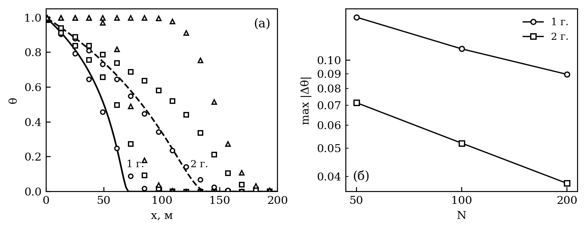
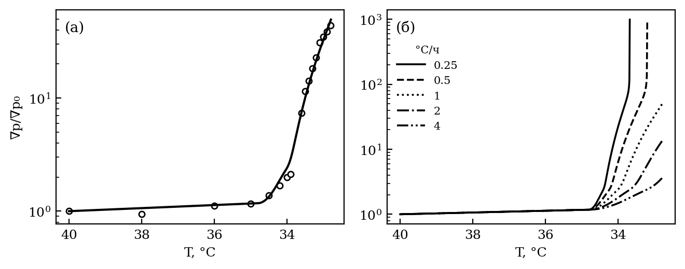
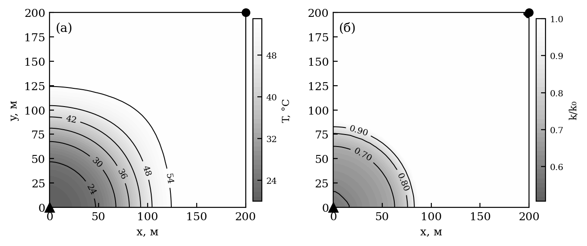
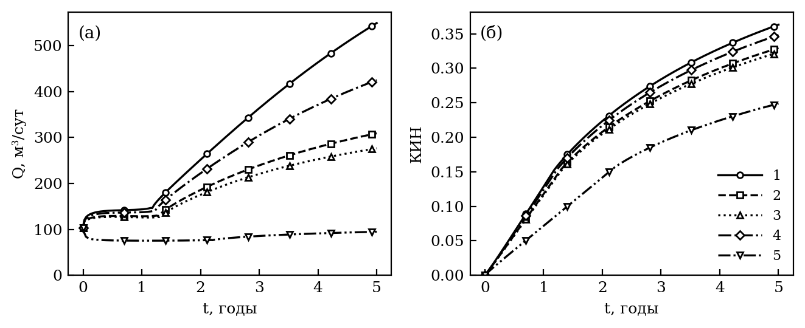
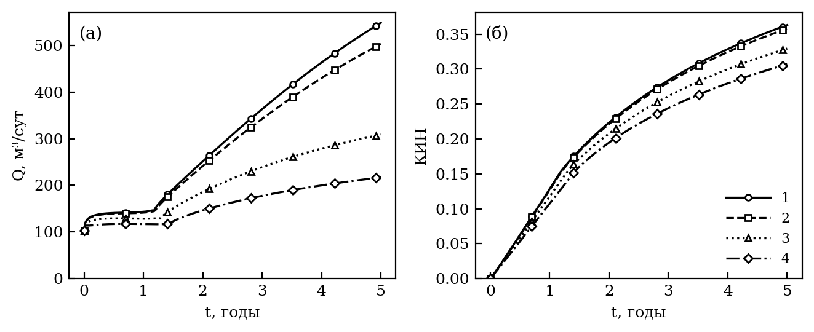

*УДК 532.546:536.24*

# ТЕПЛООБМЕН С ВМЕЩАЮЩИМИ ПОРОДАМИ И ТЕПЛОВЫЕ ЭФФЕКТЫ КРИСТАЛЛИЗАЦИИ ПАРАФИНА ПРИ ЗАВОДНЕНИИ ПЛАСТА ХОЛОДНОЙ ВОДОЙ

**А.И. Никифоров, И.С. Лазарев**

*Институт механики и машиностроения — обособленное структурное подразделение Федерального государственного бюджетного учреждения науки «Федеральный исследовательский центр «Казанский научный центр Российской академии наук», г. Казань, 420111, Россия*

*E-mail: Lazarevigor1234@yandex.ru*

Поступила в редакцию

Рассмотрено влияние теплообмена пласта с вмещающими породами и тепловых эффектов кристаллизации парафина на заводнение холодной водой. Модель неизотермической двухфазной фильтрации нефти с детальным составом учитывает скрытую теплоту кристаллизации, тепловое неравновесие флюидов и породы и теплообмен через кровлю и подошву по методу Винсома—Вестервельда. Метод воспроизводит точное решение Ловерье с отклонением безразмерной температуры {{V_VW_RMS}}, тогда как приближение ступенчатого отклика ошибается до {{V_STEP_MAX}}. Поле температуры совпадает с расчетом независимого симулятора MRST в пределах {{V_JT_DT_MEAN}} K при учете эффекта Джоуля—Томсона. Температуры трех контрольных скважин Ромашкинского месторождения описываются решением Ловерье с одним расходом только при теплообмене с вмещающими породами. Тепловой отклик проверен по керновому опыту с охлаждением 1°C/ч: число Дамкелера кристаллизации в нем порядка единицы, и при охлаждении 4°C/ч градиент давления вырастает лишь в {{A_SD_FIN_4}} раза, а при 0.25°C/ч керн закупоривается. Для элемента пласта с нефтью Жетыбая при {{F_T0}}°C закачка воды при 20°C снижает коэффициент извлечения нефти за 5 лет на {{F_COOL_LOSS}}, и {{F_WAX_SHARE}}% этого снижения дает парафин, главным образом через потерю приемистости нагнетательной скважины. Без теплообмена с вмещающими породами отложения парафина больше в {{F_HL0_WAXRATIO}} раза; взаимодействие теплообмена и парафина составляет {{F_FX_INTER_PCT}}% эффекта теплообмена. Скрытая теплота кристаллизации (число Стефана {{F_STE}}) и тепловое неравновесие на показатели разработки не влияют.

**Ключевые слова:** неизотермическая фильтрация, теплообмен с вмещающими породами, метод Винсома—Вестервельда, скрытая теплота кристаллизации, парафин, заводнение холодной водой

# ВВЕДЕНИЕ

Заводнение остается основным способом поддержания пластового давления, а закачиваемая вода, как правило, холоднее пласта. На Ромашкинском месторождении при пластовой температуре около 37°C вода поступала в пласт при 7–12°C зимой и 18–25°C летом. Через шесть лет закачки температура в скважине в 390 м от ряда нагнетательных снизилась до 26–27°C, а дебит охлажденной скважины был втрое меньше, чем у соседней, где пласт остыл лишь на 1–2°C [1]. На месторождении Узень многолетняя закачка холодной воды охладила зоны интенсивного заводнения с 60–65 до 20–30°C, ниже температуры начала кристаллизации парафина (WAT) нефти 41–44°C [2, 3]. В таких пластах охлаждение действует на добычу двумя путями: через рост вязкости нефти и через выпадение парафина в порах.

Температурное поле пласта задается тремя каналами обмена энергией [4]: конвективным переносом тепла фильтрационным потоком, кондуктивным теплообменом с вмещающими породами кровли и подошвы и источниками и стоками теплоты — от термодинамических эффектов фильтрации [5, 6] до скрытой теплоты фазовых переходов [7]. Теплообмен с вмещающими породами в моделях фильтрации нередко опускается, хотя для маломощных пластов он сопоставим с конвекцией. При закачке холодной воды знак его противоположен привычному для тепловых методов: породы, сохраняющие пластовую температуру, служат для остывающего пласта источником теплоты. Классическое решение задачи о переносе тепла в пласте с потерями во вмещающие породы получено Ловерье [8] и использовано для плоского фильтрационного течения [9]. Точный учет теплообмена требует свертки всей истории температуры на границе пласта. Винсом и Вестервельд [10] заменили ее пробным профилем температуры в породах с одной переменной состояния на ячейку, и метод получил распространение в симуляторах неизотермической фильтрации [11].

Для парафинистой нефти к этим каналам добавляются тепловые эффекты кристаллизации. Выпадение парафина выделяет скрытую теплоту. Кристаллизация идет с конечной скоростью, и при быстром охлаждении пересыщение раствора отстает от равновесия [12]. Наконец, при закачке холодной воды температуры флюидов и породы могут различаться. Насколько эти эффекты существенны в масштабе пласта и как они взаимодействуют с теплообменом с вмещающими породами, остается неясным. В модели с одним псевдокомпонентом парафина [13] взаимодействие теплообмена и парафина оказалось сильным, но механизм влияния парафина в ней сводился к вязкости нефти с кристаллами.

Цель работы — оценить роль теплообмена с вмещающими породами и тепловых эффектов кристаллизации парафина при заводнении холодной водой. Модель неизотермической фильтрации с функцией распределения пор по размерам [14], дополненная детальным составом нефти и кинетикой осаждения [15], верифицируется по точному решению Ловерье и по независимому симулятору. Ее тепловой отклик проверяется по керновому опыту с заданной скоростью охлаждения. На этой основе разделяются вклады теплообмена, температуры закачки, скрытой теплоты, кинетики кристаллизации и теплового неравновесия в повреждение пласта и показатели разработки. Механизмы кристаллизации и осаждения и их систематическое сопоставление с керновыми опытами рассмотрены в [15].

# МАТЕМАТИЧЕСКАЯ МОДЕЛЬ

## Фильтрация

Рассматривается двухфазная неизотермическая фильтрация несжимаемых воды и нефти без капиллярных и гравитационных сил. Нефть состоит из четырех групп н-алканов (C17–22, C23–30, C31–40, C41–60) в растворенном и взвешенном состоянии, асфальтенов, смол и остатка; все доли массовые. Балансы массы воды и компонента $c$ нефтяной фазы (1) и закон Дарси (2)

$$\frac{\partial (m S_i)}{\partial t} + \nabla\cdot\mathbf{U}_i = q_i, \quad i = o,\,w; \qquad \frac{\partial}{\partial t}\left(m S_o w_c\right) + \nabla\cdot\left(w_c \mathbf{U}_o\right) = q_o w_c - s_c, \qquad (1)$$

$$\mathbf{U}_i = -\frac{k f_i}{\mu_i}\nabla P, \qquad i = o,\, w, \qquad (2)$$

где $m$ — пористость; $S_o$, $S_w$ — насыщенности; $\mathbf{U}_i$ — скорости фильтрации; $q_i$ — дебиты скважин; $w_c$ — массовая доля компонента; $s_c$ — его сток в отложения; $k$ — абсолютная проницаемость; $f_i$ — относительные фазовые проницаемости Кори; $\mu_i$ — вязкости; $P$ — давление. Вязкость нефти зависит от температуры по Аррениусу и растет с долей взвешенных кристаллов; ниже точки гелеобразования нефть становится вязкопластичной. Отложения парафина, смол и асфальтенов уменьшают пористость и проницаемость; закон их накопления и связь проницаемости с отложениями описаны в [15].

## Уравнение энергии

В однотемпературном приближении баланс энергии

$$\begin{aligned}
\frac{\partial}{\partial t}&\Big[\big(m\rho_w S_w C_w + m\rho_o S_o c_o + (1-m_0)\rho_f C_f + (m_0-m)\rho_p C_p\big) T + m\rho_o S_o L_0 H_l\Big] +\\
&+ \nabla\cdot\Big[\rho_w \mathbf{U}_w C_w T + \rho_o \mathbf{U}_o\left(c_o T + L_0 H_l\right)\Big] =\\
&= \nabla\cdot\left(\Lambda\nabla T\right) + q_w \rho_w C_w T + q_o \rho_o\left(c_o T + L_0 H_l\right) - q_l,
\end{aligned} \qquad (3)$$

где $\rho_w$, $\rho_o$, $\rho_f$, $\rho_p$ — плотности воды, нефти, породы и кристаллического парафина; $C_w$, $C_f$, $C_p$ — их удельные теплоемкости; $c_o$ — эффективная теплоемкость нефтяной фазы; $m_0$ — начальная пористость; $\Lambda$ — эффективная теплопроводность; $q_l$ — объемная плотность теплового потока через кровлю и подошву. В скважинных слагаемых для нагнетательной скважины вместо $T$ берется температура закачиваемой воды $T_{inj}$. Слагаемое с $(m_0 - m)$ описывает теплоемкость отложений. В вариантах с эффектом Джоуля—Томсона [5, 6] в правую часть (3) добавляется источник $-\sum_i (1 - \beta_i T)\,\mathbf{U}_i\cdot\nabla P$ с коэффициентами теплового расширения $\beta_w = 4\cdot10^{-4}$ и $\beta_o = 7\cdot10^{-4}$ K⁻¹ (работа сил давления за вычетом теплового расширения, $T$ — абсолютная температура). Адиабатическое слагаемое $m\beta T\,\partial P/\partial t$ опущено: даже изменение давления на весь перепад между скважинами меняет им температуру пласта не более чем на {{ADIAB_DT}} K. Носитель скрытой теплоты

$$H_l = \sum_k \frac{L_k}{L_0}\, w_k^d \qquad (4)$$

— растворенный парафин, взвешенный калориметрической теплотой плавления своей группы $L_k$ по Вону [16]; $L_0$ — ее опорное значение. Энтальпия растворенного парафина больше энтальпии кристаллического на $L_k$, поэтому с носителем (4) теплота выделяется при кристаллизации — в объеме нефти или на стенках пор — и поглощается при растворении без отдельного источника.

В варианте с тепловым неравновесием температура породы $T_s$ отделена от температуры флюидов $T$, и уравнение (3) расщепляется на два, связанных объемным межфазным теплообменом:

$$\frac{\partial}{\partial t}\left[(1-m_0)\rho_f C_f T_s\right] = \nabla\cdot\left(\Lambda_s\nabla T_s\right) - h_v\left(T_s - T\right), \qquad (5)$$

а в уравнение для флюидов входит источник $h_v(T_s - T)$. Коэффициент $h_v$ находится по корреляции Вакао—Кагеи для зернистого слоя [17]. Обмен за шаг берется точной экспонентой, поэтому шаг по времени не ограничивается временем релаксации температур.

## Теплообмен с вмещающими породами

Боковые границы элемента пласта непроницаемы и теплоизолированы. Кровля и подошва непроницаемы, но через них идет кондуктивный теплообмен с вмещающими породами — полубесконечными массивами с плотностью $\rho_{ff}$, теплоемкостью $C_{ff}$, теплопроводностью $K_{ff}$ и температуропроводностью $\alpha_{ff} = K_{ff}/(C_{ff}\rho_{ff})$; теплоперенос в них одномерен и направлен по нормали к пласту. Если температуру на границе пласта считать неизменной с начала расчета (приближение ступенчатого отклика, как в решении Ловерье [8]),

$$q_l = \frac{2 K_{ff}\left(T - T_0\right)}{h\sqrt{\pi \alpha_{ff}t}}, \qquad (6)$$

где $h$ — толщина пласта, $T_0$ — начальная температура, множитель 2 учитывает кровлю и подошву. Такая схема не хранит предыстории: прогрев пород отсчитывается от начала расчета, а не от прихода теплового фронта в ячейку.

Точный поток — свертка истории температуры границы с ядром $(t-\tau)^{-1/2}$, объем вычислений которой растет со временем. Метод Винсома—Вестервельда [10] заменяет свертку пробным профилем температуры во вмещающих породах

$$T(z) - T_0 = \left(\Delta T_b + p z + q z^2\right)\exp\left(-z/d\right), \qquad d = \tfrac{1}{2}\sqrt{\alpha_{ff}t}, \qquad (7)$$

где $z$ — расстояние от границы пласта, $\Delta T_b = T - T_0$. Параметры $p$ и $q$ определяются из уравнения теплопроводности на границе и из равенства интеграла профиля накопленной в породах энергии $E_{ff}$:

$$\frac{\Delta T_b}{d^2} - \frac{2p}{d} + 2q = \frac{1}{\alpha_{ff}}\frac{\partial T}{\partial t}, \qquad \Delta T_b\, d + p\, d^2 + 2 q\, d^3 = E_{ff}, \qquad q_l = \frac{2 K_{ff}}{h}\left(\frac{\Delta T_b}{d} - p\right). \qquad (8)$$

Величина $E_{ff}$ — единственная переменная состояния метода; она накапливается в каждой ячейке независимо. Теплоизолированным кровле и подошве отвечает $q_l \equiv 0$. При закачке воды холоднее пласта $q_l < 0$: теплота поступает из вмещающих пород.

## Кристаллизация парафина

Предел растворимости каждой группы парафина задан уравнением идеальной растворимости с эффективной теплотой и температурами плавления, подобранными по кривой выпадения парафина нефти, с поправкой Пойнтинга на давление:

$$\ln x_k^{sat} = -\frac{\Delta H_{eff}}{R}\left(\frac{1}{T} - \frac{1}{T_{m,k}}\right) - \frac{\Delta v_k\,(P - P_{ref})}{R T}, \qquad (9)$$

где $x_k^{sat}$ — мольная доля группы в насыщенном растворе; $R$ — универсальная газовая постоянная; $T_{m,k}$ — температура плавления группы; $\Delta v_k$ — скачок молярного объема при плавлении. Растворенный газ добавляет моли в раствор и понижает WAT живой нефти. Равновесие достигается с конечной скоростью: пересыщение $\Delta$ снимается параллельно кристаллизацией в объеме нефти и на стенках пор,

$$\frac{d w_s}{dt} = k_{cr}\,\Delta, \qquad \Delta^{wall} = \frac{k_{wall}}{k_{wall} + k_{cr}}\left(1 - e^{-(k_{wall} + k_{cr})\Delta t}\right)\Delta, \qquad (10)$$

где $w_s$ — доля взвешенных кристаллов; $k_{cr}$, $k_{wall}$ — константы скорости; $\Delta^{wall}$ — часть пересыщения, уходящая на стенки за шаг $\Delta t$. Отношение скорости кристаллизации к скорости охлаждения $v_T$ задает число Дамкелера $\mathrm{Da} = k_{cr}/v_T$ (на 1°C интервала выпадения): при $\mathrm{Da} \gg 1$ кристаллизация равновесна, при $\mathrm{Da} \lesssim 1$ пересыщение отстает от равновесия. Кристаллизация на стенках сужает поровые каналы, а взвешенные кристаллы переносятся к стенкам и блокируют узкие каналы [15]. В варианте с растворением отложений недосыщенная нефть растворяет осадок на стенках с той же константой $k_{wall}$, пока не достигнет предела растворимости.

## Метод решения

Уравнения дискретизированы методом контрольных объемов на прямоугольной сетке, конвективные слагаемые — разностью против потока. Давление находится неявно, насыщенность, состав и температура — явно (метод IMPES); уравнение давления решается методом сопряженных градиентов с многосеточным предобусловливателем. Шаг по времени подбирается на каждой итерации по числам Куранта уравнений переноса насыщенности, состава и температуры. Энергия (3) записана в консервативной форме относительно $\psi T$, где $\psi$ — объемная теплоемкость ячейки. Скрытая теплота входит через изменение $m S_o H_l$ за шаг, поэтому баланс энергии при кристаллизации и растворении выполняется точно. Скважины неявны по давлению (формула Писмана с текущей проницаемостью ячейки). Переменная $E_{ff}$ в (8) обновляется в каждой ячейке после шага по температуре. Теплофизические свойства, общие для всех расчетов, приведены в табл. 1.

Таблица 1. Теплофизические свойства

| Среда | Плотность, кг/м³ | Теплоемкость, Дж/(кг·°C) | Теплопроводность, Вт/(м·°C) |
|---|---|---|---|
| Вода | 1000 | 4200 | 0.6 |
| Нефть | 860 | 2000 | 0.12 |
| Кристаллический парафин | 900 | 2200 | 0.2 |
| Порода пласта | 2700 | 1000 | 1.8 |
| Вмещающие породы | 2400 | 1000 | 2.0 |

# ВЕРИФИКАЦИЯ ТЕПЛОВОЙ ЧАСТИ

## Точное решение Ловерье

Рассмотрим закачку холодной воды с постоянным расходом $Q$ в водонасыщенную полосу длиной 200 м, шириной 200 м и толщиной $h = 10$ м с теплообменом через кровлю и подошву. Если пренебречь теплопроводностью вдоль пласта, распределение температуры дается решением Ловерье [8], которое преобразованием Лапласа по времени приводится к виду

$$\theta = \frac{T - T_0}{T_{inj} - T_0} = \operatorname{erfc}\left[\frac{x\sqrt{K_{ff}\rho_{ff}C_{ff}}}{h\,U\sqrt{t - Mx/U}}\right], \quad t > \frac{Mx}{U}; \qquad \theta = 0, \quad t \le \frac{Mx}{U}, \qquad (11)$$

где $U = \rho_w C_w Q/A$ — конвективный поток теплоемкости через сечение $A$; $M = (1 - m)\rho_f C_f + m\rho_w C_w$ — объемная теплоемкость пласта. Решение (11) отвечает точной свертке истории температуры на границе пласта. Расчет выполнен при $Q = {{V_Q}}$ м³/сут, $T_0 = 70$°C, $T_{inj} = 20$°C и свойствах пород из табл. 1. Сетка — 100 ячеек; для проверки сходимости — также {{V_GRID}} ячеек.

Метод Винсома—Вестервельда (7), (8) воспроизводит решение (11) с наибольшим отклонением безразмерной температуры {{V_VW_MAX}} и среднеквадратичным {{V_VW_RMS}} (рис. 1а). Ступенчатая схема (6) отстает от точного решения на {{V_STEP_MAX}}: она отсчитывает прогрев вмещающих пород от начала расчета, тогда как к точке $x$ тепловой фронт приходит позже, и поток тепла в ней завышен. Без теплообмена отклонение достигает {{V_NONE_MAX}}. Наибольшая ошибка метода Винсома—Вестервельда приходится на передний край охлажденной зоны, где решение (11) крутое и сказывается численная диффузия разностей против потока. При {{V_GRID}} ячейках она составляет {{V_GRID_ERR}} (рис. 1б), то есть убывает с измельчением сетки с эффективным порядком {{V_ORDER}}.

## Сравнение с независимым симулятором

Двухфазная часть и уравнение энергии сопоставлены с модулем geothermal пакета MRST 2024a [18] на задаче о закачке воды при 20°C в пятиточечный элемент 200 × 200 × 10 м с пластовой температурой 70°C ({{V_MRST_N}} × {{V_MRST_N}} ячеек, 1000 сут). Приемистость нагнетательной скважины совпадает с точностью {{V_MRST_QINJ}}% в норме $L_2$, давление — со среднеквадратичным отклонением {{V_MRST_DP}} бар. Среднее по полю отклонение температуры не превышает {{V_MRST_DT_MEAN}} K, наибольшее — {{V_MRST_DT_MAX}} K. Это меньше нагрева воды трением при дросселировании $(P_w - P_o)/(\rho_w C_w) = {{V_FRICTION}}$ K, который MRST учитывает. С источником Джоуля—Томсона расхождение снижается до {{V_JT_DT_MEAN}} K в среднем и {{V_JT_DT_MAX}} K наибольшего, по приемистости — до {{V_JT_QINJ}}%, то есть остававшееся различие объяснялось именно этим эффектом.

## Охлаждение пласта по промысловым данным

Данные контрольных скважин Ромашкинского месторождения [1] позволяют проверить, что наблюдаемое охлаждение пласта определяется теплообменом с вмещающими породами. Закачка началась в 1960 г. при приемистости скважин 700–1800 м³/сут; толщина пласта около 10 м, пластовая температура 37°C. Через 6 лет температура составляла 23°C в 250 м от нагнетательной скважины и 26–27°C в 390 м от ряда нагнетательных скважин, а в 600 м снизилась лишь на 1–2°C [1]. Течение от ряда скважин близко к плоскому, поэтому решение (11) с неизвестным расходом на единицу длины ряда $q$ можно обратить по каждому наблюдению. Температура закачки принята среднегодовой, 12.5–18.5°C по краям указанных в [1] интервалов, свойства пород — по табл. 1, так как в [1] они не приведены. Три наблюдения независимо дают $q$ = {{ROM_Q_RANGE}} м²/сут, то есть описываются одним расходом, отвечающим расстоянию между скважинами ряда {{ROM_SPACING}} м; при среднегодовой температуре закачки 15.5°C решение (11) с этим расходом дает {{ROM_T250}}, {{ROM_T390}} и {{ROM_T600}}°C. Без теплообмена решение (11) промежуточных температур не дает: позади резкого фронта пласт охлажден до температуры закачки, впереди не охлажден. Общий расход для трех скважин существует при $K_{ff}$ = {{ROM_K_OK}} Вт/(м·°C) и отсутствует при {{ROM_K_BAD}} Вт/(м·°C). Таким образом, плавное распределение температуры, наблюдаемое в пласте, создается теплообменом с вмещающими породами. Через сечение 600 м за 6 лет, по этой оценке, прошло {{ROM_PV600_ALL}} поровых объемов воды при пористости 0.2–0.3, тогда как в [1] указано 1–2; причиной может быть неоднородность охвата пласта заводнением, сведений о которой в [1] нет.

# ТЕПЛОВОЙ ОТКЛИК КЕРНА

## Охлаждение керна с заданной скоростью

Конечная скорость кристаллизации делает результат кернового опыта зависящим от скорости охлаждения. Наиболее полно это видно в опыте Sandyga и др. [19]. Через керн песчаника (диаметр 3 см, длина 5 см, пористость 9%) прокачивался раствор 20% масс. парафина в керосине со скоростью 0.5 см³/мин, а термошкаф охлаждался с 40 до 32.8°C со скоростью 1°C/ч. Градиент давления при этом вырос в 44 раза. Объемная WAT раствора, измеренная реометром при охлаждении 1°C/мин, составляет 30°C, а градиент давления растет уже при 34.5°C. Авторы объясняют разницу кристаллизацией на стенках пор [19, 20]. Два независимых измерения той же лаборатории показывают, что объяснения требуют и кинетика, и минеральная поверхность. При замедлении охлаждения с 0.042 до 0.001°C/с WAT 30%-го раствора растет на {{SD_RATE_SPAN}}°C, а частицы песчаника повышают ее еще на 2.6–2.8°C [21]. Кинетика кристаллизации (10) с той же константой $k_{cr}$, что в расчете керна, воспроизводит зависимость WAT от скорости охлаждения с отклонением {{A_RATE_RMS}}°C, если реометр замечает кристаллы при их доле {{A_RATE_THR}}% массы раствора. Объемную WAT 20%-го раствора при скорости реометра модель дает {{A_RATE_BULK20}}°C против измеренных 30°C. Оставшиеся 2°C объяснимы способом измерения: излом кривой вязкости отмечает образование сетки кристаллов, а не появление первых кристаллов [19]. Поэтому температура плавления в (9) для пористой среды задана так, что WAT составляет {{SD_WAT}}°C — выше объемной, в пределах суммы кинетического и минерального сдвигов.

С параметрами осаждения, общими для всех керновых опытов [15], модель описывает рост градиента давления со среднеквадратичным отклонением {{A_SD_RMSLG}} в шкале $\lg(\nabla p/\nabla p_0)$ при пороге точности оцифровки {{SD_NOISE}} (рис. 2а). Время кристаллизации в объеме $1/k_{cr} = {{U_TCS}}$ мин сопоставимо со временем охлаждения на 1°C, поэтому число Дамкелера $\mathrm{Da} = {{A_SD_DA_1}}$ — режим, в котором результат наиболее чувствителен к скорости охлаждения. Прогноз модели с теми же параметрами показан на рис. 2б. При 0.25°C/ч ($\mathrm{Da} = {{A_SD_DA_0_25}}$) пересыщение снимается на стенках пор у самой WAT, и керн закупоривается уже при {{A_SD_TEND_0_25}}°C, при 0.5°C/ч — при {{A_SD_TEND_0_5}}°C. При 4°C/ч ($\mathrm{Da} = {{A_SD_DA_4}}$) пересыщение отстает от равновесия, и градиент вырастает лишь в {{A_SD_FIN_4}} раза. Керновый опыт при двух скоростях охлаждения позволил бы проверить кинетику непосредственно в пористой среде.

# ЗАВОДНЕНИЕ ЭЛЕМЕНТА ПЛАСТА

## Постановка

Рассматривается элемент симметрии пятиточечной системы заводнения 200 × 200 м толщиной $h = 10$ м (сетка 50 × 50, по радиусам капилляров 31 узел). Нагнетательная и добывающая скважины радиусом 0.1 м расположены в противоположных углах и работают при забойных давлениях 17 и 7 МПа; начальное давление 12 МПа, расчет — на 5 лет. Нефть — нефть Жетыбая [22] с содержанием парафина {{F_WAX0}}% масс., смол 5.52% и асфальтенов 0.91%, давление насыщения 9.5 МПа. Пластовая температура $T_0 = {{F_T0}}$°C выше WAT живой нефти ({{F_WAT0}}°C) не менее чем на 15°C, так что вода с температурой 20°C переводит нефть через WAT в середине перепада температур. Параметры осаждения подобраны по керну с той же нефтью [22]: общий набор на все керновые опыты описывает ступень 25°C этого керна хуже [15]. Базовый вариант — закачка воды при 20°C с теплообменом по методу Винсома—Вестервельда. Остальные варианты отличаются от базового одним фактором, а варианты с нефтью без парафина вместе с базовым и вариантом без теплообмена образуют полный факторный план по двум факторам. Показатели вариантов через 5 лет приведены в табл. 2.

Базовый вариант рассчитан также на сетках 25 × 25, 75 × 75 и 100 × 100. Средняя температура пласта через 5 лет на четырех сетках составляет {{F_BASE_G25_TMEAN}}, {{F_BASE_TMEAN}}, {{F_BASE_G75_TMEAN}} и {{F_BASE_G100_TMEAN}}°C: тепловое поле от сетки почти не зависит. Показатели разработки зависят от нее через повреждение в ячейках скважин, которое прямоугольная сетка не разрешает. В ячейке нагнетательной скважины $k/k_0 \approx {{F_BASE_KINJ}}$ на всех сетках, но ячейка уменьшается с 8 до 2 м, и скин-фактор снижается с {{F_BASE_G25_SKIN}} до {{F_BASE_G100_SKIN}}. В ячейке добывающей скважины оседают асфальтены, выпадающие у давления насыщения [15]; давление в этой ячейке зависит от ее размера, и $k/k_0$ в ней составляет {{F_BASE_G25_KPROD}}, {{F_BASE_KPROD}}, {{F_BASE_G75_KPROD}} и {{F_BASE_G100_KPROD}}. Поэтому КИН немонотонен по сетке ({{F_BASE_G25_RF}}, {{F_BASE_RF}}, {{F_BASE_G75_RF}} и {{F_BASE_G100_RF}}), а на сетке 100 × 100, где осадок у добывающей скважины образуется только в варианте без парафина ($k/k_0$ = {{F_NOWAX_G100_KPROD}}), разность этих вариантов меняет знак. На сетках 50 × 50 и 75 × 75 осадок есть во всех вариантах, и разности тепловых вариантов согласуются: закачка при 20°C снижает КИН относительно изотермической на {{F_COOL_LOSS}} и {{F75_COOL}}, парафин дает {{F_WAX_SHARE}} и {{F75_SHARE}}% этого снижения, взаимодействие теплообмена и парафина составляет {{F_FX_INTER_PCT}} и {{F75_INTER_PCT}}% эффекта теплообмена. Выводы ниже опираются на сравнение вариантов на сетке 50 × 50; абсолютные значения КИН и вклад парафина следует считать оценкой, для количественного прогноза нужна локальная радиальная сетка у скважин.

## Тепловой фронт

Тепловой фронт отстает от фронта вытеснения (рис. 3а). Через год вода продвинулась по диагонали на {{F_FRONT_W}} м, а изотерма середины перепада температур — на {{F_FRONT_T}} м. Тепловой фронт движется со скоростью $U\rho_w C_w/C_{eff}$, то есть составляет $m\rho_w C_w/C_{eff} = {{F_VT_RATIO}}$ средней скорости воды в порах, а фронт вытеснения движется быстрее нее. То же отставание холодного фронта наблюдалось в опыте с закачкой холодной воды в пласт с парафинистой нефтью [23]. Тепловое число Пекле радиального течения у скважины $\mathrm{Pe} = Q\rho_w C_w/(2\pi h\Lambda) = {{F_PE}}$, где $Q$ — приемистость: тепло переносится конвекцией, а размывают фронт охлаждения (перепад от 10 до 90% занимает около {{F_WIDTH}} м) теплообмен с вмещающими породами и теплопроводность. Через 5 лет ниже WAT охлаждено {{F_BASE_BELOW}}% площади элемента, средняя температура пласта {{F_BASE_TMEAN}}°C.

Парафин выпадает в охлажденной зоне позади фронта вытеснения; всего осело {{F_BASE_WAX}} т. Проницаемость снижена в зоне у нагнетательной скважины (рис. 3б), в ее ячейке $k/k_0 = {{F_BASE_KINJ}}$ и скин-фактор {{F_BASE_SKIN}}: через ячейку скважины проходит вся нефть, охлажденная в первые месяцы закачки. К моменту, когда изотерма WAT достигает удаленной ячейки, большая часть нефти в ней уже вытеснена, и кристаллы в остаточной нефти остаются неподвижной взвесью. Это согласуется с опытом закачки холодной воды в керн с остаточной нефтью, где охлаждение ниже точки помутнения проницаемость по воде не снижало [23].

Таблица 2. Показатели вариантов через 5 лет

{{A_T_FIELD}}

## Теплообмен с вмещающими породами и содержание парафина

При закачке воды холоднее пласта вмещающие породы служат для него источником теплоты. Без теплообмена с кровлей и подошвой средняя температура пласта через 5 лет {{F_HL0_TMEAN}}°C против {{F_BASE_TMEAN}}°C, ниже WAT охлаждено {{F_HL0_BELOW}}% площади против {{F_BASE_BELOW}}%, а парафина выпадает в {{F_HL0_WAXRATIO}} раза больше ({{F_HL0_WAX}} т). Разделить вклады теплообмена и парафина позволяет полный факторный план (табл. 3, рис. 4).

Таблица 3. Разложение эффектов по полному факторному плану через 5 лет

{{T3}}

Для нефти без парафина пренебрежение теплообменом снижает КИН на {{F_FX_HL_NOWAX}} — через рост вязкости охлажденной нефти, а для парафинистой — на {{F_FX_HL_WAX}}. Взаимодействие факторов {{F_FX_INTER_SIGNED}} составляет {{F_FX_INTER_PCT}}% эффекта теплообмена. Парафин снижает КИН на {{F_FX_WAX_HL}} при учете теплообмена и на {{F_FX_WAX_NOHL}} без него и дает {{F_WAX_SHARE}}% всей потери КИН от охлаждения ({{F_COOL_LOSS}}: закачка при 20°C против изотермической). Основной канал его влияния — приемистость: с парафином закачано на {{F_WAX_INJ_PCT}}% меньше воды (рис. 4а). Рост отложений без теплообмена снижает КИН меньше, чем можно было бы ожидать: дополнительный парафин оседает в промытой зоне, где нефть почти неподвижна, а зону у скважины, определяющую приемистость, конвекция охлаждает до температуры закачки при любом теплообмене.

В расчете той же постановки по модели с одним равновесно кристаллизующимся псевдокомпонентом парафина [14] разложение эффектов выглядело иначе. Парафин снижал КИН лишь на {{OLD_FX_WAX_HL}} при учете теплообмена и на {{OLD_FX_WAX_NOHL}} без него, а взаимодействие факторов составляло {{OLD_FX_INTER_PCT}}% их суммарного эффекта. В той модели кристаллы влияли на вытеснение только через вязкость подвижной нефти, и их положение относительно фронта вытеснения зависело от теплообмена. В настоящей модели главный канал влияния парафина — потеря приемистости нагнетательной скважины, а призабойную зону конвекция охлаждает до температуры закачки при любом теплообмене. Поэтому вывод о сильном взаимодействии факторов отражает механизм упрощенной модели, а не свойство пласта.

Ступенчатая схема (6) занижает теплоприток из вмещающих пород: ниже WAT охлаждено {{F_HL1_BELOW}}% площади, парафина выпадает на {{F_HL1_WAXPCT}}% больше, чем по методу Винсома—Вестервельда, а КИН ниже на {{F_HL1_DRF_ABS}}. По КИН она воспроизводит {{F_HL1_SHARE}}% эффекта теплообмена, не меняя его знака. Расхождение двух схем меньше самого эффекта теплообмена, поэтому вывод о необходимости его учитывать от выбора приближения не зависит, но для количественного прогноза предпочтителен метод Винсома—Вестервельда.

## Толщина пласта и теплопроводность вмещающих пород

Роль теплообмена определяет отношение теплоты, которую за время $t$ отдает пласту прилегающий слой кровли и подошвы, к теплоемкости самого пласта:

$$\Gamma = \frac{2\sqrt{K_{ff}\rho_{ff}C_{ff}\,t/\pi}}{h M}. \qquad (12)$$

При $h$ = 5, 10 и 20 м через 5 лет $\Gamma$ = {{LAM_H5}}, {{LAM_H10}} и {{LAM_H20}}. Без теплообмена задача подобна по толщине: КИН при всех трех толщинах один и тот же ({{F_H5_HL0_RF}}), а отложения парафина пропорциональны $h$ (табл. 4). С теплообменом КИН выше на {{HL_EFF_H5}}, {{HL_EFF_H10}} и {{HL_EFF_H20}}: эффект растет с $\Gamma$, но медленнее, чем пропорционально, потому что призабойную зону, определяющую приемистость, конвекция охлаждает при любом $\Gamma$. Сильнее $\Gamma$ сказывается на отложениях: без теплообмена парафина выпадает больше в {{H5_WAXRATIO}}, {{F_HL0_WAXRATIO}} и {{H20_WAXRATIO}} раза. Теплопроводность вмещающих пород 1.5 и 3.0 Вт/(м·°C) ($\Gamma$ = {{LAM_KFF15}} и {{LAM_KFF30}}) меняет КИН базового варианта лишь на {{KFF15_DRF}} и {{KFF30_DRF}}: в пределах неопределенности $K_{ff}$ теплообмен определяется в первую очередь толщиной пласта.

Таблица 4. Толщина пласта и теплообмен с вмещающими породами через 5 лет

{{A_T_THICK}}

## Температура закачки

Температура закачиваемой воды — главный термический фактор (табл. 2, рис. 5). При изотермической закачке ({{F_T0}}°C) за 5 лет закачано {{F_TISO_INJ}} тыс. м³ воды, КИН {{F_TISO_RF}}. При 40°C нефть не охлаждается ниже WAT живой нефти, парафин не выпадает, и КИН снижается лишь до {{F_T40_RF}} — за счет роста вязкости охлажденной нефти. Ниже WAT потери растут резко: при 20°C КИН {{F_BASE_RF}}, при 5°C — {{F_T5_RF}}, скин-фактор нагнетательной скважины {{F_BASE_SKIN}} и {{F_T5_SKIN}}. При 20°C воды закачано на {{F_INJ_LOSS}}% меньше, чем при изотермической закачке. Зимой и летом температура закачки различается: на Ромашкинском месторождении — 7–12 и 18–25°C [1]. При колебании 20 ± 8°C с периодом в год, то есть при той же средней температуре, КИН ниже, чем при постоянных 20°C, на {{F_SEASON_DRF_ABS}}, а скин-фактор нагнетательной скважины растет до {{F_SEASON_SKIN}}: зимняя вода дает у скважины больше отложений, а летний прогрев их не убирает. Если недосыщенная нефть растворяет осадок, потеря КИН снижается до {{F_SEASON_DISS_DRF_ABS}}, скин-фактор — до {{F_SEASON_DISS_SKIN}}. Поэтому при сезонной закачке повреждение задает наиболее холодная вода, а обратимость повреждения — растворение отложений при нагреве.

## Скрытая теплота, дросселирование, кинетика кристаллизации и тепловое неравновесие

Скрытая теплота кристаллизации на температурное поле практически не влияет. Число Стефана — отношение ощутимой теплоты охлаждения пласта с {{F_T0}} до 20°C к скрытой теплоте выпадающего при этом парафина ({{F_WPREC}}% масс.) — даже при начальной нефтенасыщенности составляет $\mathrm{Ste} = C_{eff}\Delta T/(m S_o \rho_o \Delta w L_0) = {{F_STE}}$, и без слагаемых с носителем (4) в (3) КИН меняется на {{F_NOLATENT_DRF}}.

Нагрев при дросселировании (эффект Джоуля—Томсона) ограничен перепадом давления между скважинами: вода, прошедшая весь перепад 10 МПа, нагрелась бы на {{JT_DT_FLOW}} K. Средняя температура пласта с ним выше на {{JT_DT}} K, а у добывающей скважины, где градиент давления наибольший, — на {{JT_DT_PROD}} K. Парафина выпадает на {{JT_WAX_PCT}}% меньше, но КИН ниже на {{F_JT_DRF_ABS}}: нагрев усиливает осаждение асфальтенов в ячейке добывающей скважины ($k/k_0$ = {{F_JT_KPROD}} против {{F_BASE_KPROD}}). Поскольку этот осадок зависит от размера ячейки, эффект следует считать оценкой; на поле температуры и отложения парафина дросселирование влияет слабо.

Кинетика кристаллизации проявляется в пласте не запаздыванием, а разделом пересыщения между объемом нефти и стенками пор. Частица нефти охлаждается за время прохождения размытого теплового фронта около {{F_TPASS}} сут, и число Дамкелера $k_{cr} t \sim {{F_DA}}$, так что пересыщение снимается за один шаг по времени. По (10) {{F_WALL_SHARE}}% его кристаллизуется на стенках и равномерно сужает каналы. При равновесной кристаллизации весь избыток уходит во взвесь, и кристаллы блокируют узкие каналы у нагнетательной скважины: скин-фактор {{F_EQUIL_SKIN}} против {{F_BASE_SKIN}}, КИН ниже на {{F_EQUIL_DRF_ABS}}. В керне, напротив, $\mathrm{Da} \sim 1$ (рис. 2б), и кинетика проявляется запаздыванием.

Тепловое неравновесие флюидов и породы пренебрежимо. Время релаксации их температур для зерна {{F_DG}} мм даже при наименьшем числе Нуссельта ($\mathrm{Nu} = 2$) составляет {{F_TAU_LTNE}} с, много меньше шага по времени, и расчет с отдельной температурой породы (5) совпадает с однотемпературным с относительной точностью {{F_LTNE_REL}}.

# ЗАКЛЮЧЕНИЕ

1. Метод Винсома—Вестервельда воспроизводит точное решение Ловерье с отклонением безразмерной температуры {{V_VW_RMS}} в среднем и {{V_VW_MAX}} на крутом переднем крае охлажденной зоны, тогда как ступенчатая схема ошибается на {{V_STEP_MAX}}. Расчет закачки холодной воды совпадает с независимым симулятором MRST по температуре с точностью {{V_JT_DT_MEAN}} K в среднем, если учтен нагрев воды при дросселировании (без него — {{V_MRST_DT_MEAN}} K). Обращение решения Ловерье по данным контрольных скважин Ромашкинского месторождения показывает, что наблюдаемое плавное распределение температуры создается теплообменом с вмещающими породами с теплопроводностью {{ROM_K_OK}} Вт/(м·°C).

2. В керне число Дамкелера кристаллизации близко к единице, и результат опыта зависит от скорости охлаждения: при 4°C/ч градиент давления вырастает к концу охлаждения в {{A_SD_FIN_4}} раза, а при 0.25°C/ч керн закупоривается уже при {{A_SD_TEND_0_25}}°C. Сдвиг WAT в пористой среде относительно объема объясняется разницей скоростей охлаждения и влиянием минеральной поверхности.

3. Главный термический фактор — температура закачиваемой воды: коэффициент извлечения нефти за 5 лет составляет {{F_TISO_RF}}, {{F_T40_RF}}, {{F_BASE_RF}} и {{F_T5_RF}} при {{F_T0}}, 40, 20 и 5°C. Выше WAT охлаждение снижает его только через вязкость нефти, ниже WAT парафин дает {{F_WAX_SHARE}}% потери, главным образом через приемистость.

4. При закачке холодной воды вмещающие породы служат для пласта источником теплоты. Без теплообмена с ними отложения парафина больше в {{F_HL0_WAXRATIO}} раза, а КИН ниже на {{F_FX_HL_WAX}}. Взаимодействие теплообмена и парафина составляет {{F_FX_INTER_PCT}}% эффекта теплообмена: призабойную зону, определяющую приемистость, конвекция охлаждает при любом теплообмене. Ступенчатая схема Ловерье воспроизводит {{F_HL1_SHARE}}% эффекта теплообмена. Роль теплообмена задает параметр $\Gamma$ (12): при толщине пласта 5, 10 и 20 м эффект теплообмена на КИН составляет {{HL_EFF_H5}}, {{HL_EFF_H10}} и {{HL_EFF_H20}}, на отложения — {{H5_WAXRATIO}}, {{F_HL0_WAXRATIO}} и {{H20_WAXRATIO}} раза; теплопроводность вмещающих пород в пределах 1.5–3.0 Вт/(м·°C) влияет на КИН меньше, чем на 0.001.

5. Скрытая теплота кристаллизации (число Стефана {{F_STE}}) и тепловое неравновесие флюидов и породы (время релаксации {{F_TAU_LTNE}} с) на показатели разработки не влияют; нагрев при дросселировании повышает среднюю температуру пласта лишь на {{JT_DT}} K. Кинетика кристаллизации в пласте проявляется не запаздыванием, а разделом пересыщения между объемом нефти и стенками пор: равновесная кристаллизация завышает скин-фактор нагнетательной скважины до {{F_EQUIL_SKIN}} против {{F_BASE_SKIN}}.

Работа выполнена за счет предоставленного в 2026 году Фондом науки и технологий Республики Татарстан гранта на осуществление фундаментальных и поисковых исследований в научных и образовательных организациях, предприятиях и организациях реального сектора экономики Республики Татарстан.

# СПИСОК ЛИТЕРАТУРЫ

1. *Сандыга М.С., Стручков И.А., Рогачев М.К.* Исследование температурных условий образования органических отложений в продуктивном пласте при скважинной добыче парафинистой нефти // Недропользование. 2021. Т. 21. № 2. С. 84.
2. *Togasheva A., Bayamirova R., Saduakassov D., Zholbasarova A., Nurlybai N., Nugumarov Y.* Risk Assessment of Asphaltene–Resin–Paraffin Deposition During Reservoir Cooling in the XIII Horizon of the Uzen Oil Field // Eng. 2026. V. 7. № 4. P. 184.
3. *Bayamirova R., Togasheva A., Zholbasarova A., Sarbopeyeva M.* Displacement of High-Parafin Oil from Formations by Injected Cold Water // Engineering for Rural Development. 2024. V. 23. P. 1048.
4. *Филиппов А.И., Михайлов П.Н., Филиппов К.А., Салихов Р.Ф., Ковальский А.А.* Использование баротермического эффекта для нагрева нефтяного пласта // ТВТ. 2009. Т. 47. № 5. С. 752.
5. *Сулейманова М.Д., Шарафутдинов Р.Ф., Канафин И.В.* Исследование распределения температуры в неоднородном пласте при фильтрации флюида с учетом термодинамических эффектов // Вестник Тюменского государственного университета. Физико-математическое моделирование. Нефть, газ, энергетика. 2023. Т. 9. № 1. С. 6.
6. *Исламов Д.Ф., Рамазанов А.Ш., Давлетшин Ф.Ф., Акчурин Р.З.* Моделирование теплового поля при двухфазной фильтрации нефти и воды в неоднородном пласте с учетом термодинамических эффектов // Известия Томского политехнического университета. Инжиниринг георесурсов. 2026. Т. 337. № 6. С. 110.
7. *Borodin S.L., Musakaev N.G., Belskikh D.S.* Mathematical Modeling of a Non-Isothermal Flow in a Porous Medium Considering Gas Hydrate Decomposition: A Review // Mathematics. 2022. V. 10. № 24. P. 4674.
8. *Lauwerier H.A.* The Transport of Heat in an Oil Layer Caused by the Injection of Hot Fluid // Appl. Sci. Res. Sect. A. 1955. V. 5. P. 145.
9. *Алишаев М.Г.* Расчет температурного поля пласта при инжекции жидкости для плоского фильтрационного течения // Изв. АН СССР. МЖГ. 1979. № 1. С. 67.
10. *Vinsome P.K.W., Westerveld J.* A Simple Method for Predicting Cap and Base Rock Heat Losses in Thermal Reservoir Simulators // J. Can. Pet. Technol. 1980. V. 19. № 3. P. 87.
11. *Pruess K., Oldenburg C., Moridis G.* TOUGH2 User's Guide, Version 2. Report LBNL-43134. Berkeley: Lawrence Berkeley National Laboratory, 1999.
12. *Huang Z., Lee H.S., Senra M., Fogler H.S.* A Fundamental Model of Wax Deposition in Subsea Oil Pipelines // AIChE J. 2011. V. 57. № 11. P. 2955.
13. *Nikiforov A.I., Sadovnikov R.V., Nikiforov G.A.* Modeling of Paraffin Deposition During Oil Production by Cold Water Injection // Lobachevskii J. Math. 2022. V. 43. № 5. P. 1178.
14. *Lazarev I.S., Nikiforov A.I.* Modeling of Paraffin Deposition During Flooding of Oil Reservoirs with Cold Water // Lobachevskii J. Math. 2026. V. 47. № 6. P. 2671.
15. *Никифоров А.И., Лазарев И.С.* Кристаллизация парафинов и осаждение асфальтосмолопарафиновых веществ в пористой среде: модель с детальным составом нефти и систематическое сопоставление с экспериментами. [TODO: выходные данные после принятия статьи; ТВТ не принимает ссылок на неопубликованные работы]
16. *Won K.W.* Thermodynamics for Solid Solution-Liquid-Vapor Equilibria: Wax Phase Formation from Heavy Hydrocarbon Mixtures // Fluid Phase Equilib. 1986. V. 30. P. 265.
17. *Wakao N., Kaguei S.* Heat and Mass Transfer in Packed Beds. N.Y.: Gordon and Breach, 1982. 364 p.
18. *Lie K.-A.* An Introduction to Reservoir Simulation Using MATLAB/GNU Octave: User Guide for the MATLAB Reservoir Simulation Toolbox (MRST). Cambridge: Cambridge University Press, 2019. 660 p.
19. *Sandyga M.S., Struchkov I.A., Rogachev M.K.* Formation Damage Induced by Wax Deposition: Laboratory Investigations and Modeling // J. Pet. Explor. Prod. Technol. 2020. V. 10. P. 2541.
20. *Рогачев М.К., Сандыга М.С.* Породы-коллекторы. Исследование условий образования органических отложений в поровом пространстве // Neftegaz.RU. 2019. № 7.
21. *Struchkov I.A., Rogachev M.K.* Wax Precipitation in Multicomponent Hydrocarbon System // J. Pet. Explor. Prod. Technol. 2017. V. 7. № 2. P. 543.
22. *Li X., Zhao L., Fei R., Zhou F., Yuan S. et al.* Cooling Damage Characterization and Chemical-Enhanced Oil Recovery in Low-Permeable and High-Waxy Oil Reservoirs // Processes. 2024. V. 12. № 2. P. 421.
23. *Maloney D., Oesthus A.* Effects of Paraffin Wax Precipitation During Cold Water Injection in a Fractured Carbonate Reservoir // Proc. Int. Symp. Society of Core Analysts. Abu Dhabi, 2004. Paper SCA2004-28.

# ПОДПИСИ К РИСУНКАМ

Рис. 1. Безразмерная температура $\theta$ при закачке холодной воды с постоянным расходом в водонасыщенную полосу с теплообменом через кровлю и подошву: (а) — распределение по длине через 1 (сплошная линия) и 2 года (штриховая): линии — точное решение Ловерье (11), кружки — метод Винсома—Вестервельда, квадраты — ступенчатая схема (6), треугольники — без теплообмена; (б) — наибольшее отклонение метода Винсома—Вестервельда от точного решения в зависимости от числа ячеек $N$.

Рис. 2. Отношение градиента давления к начальному при охлаждении керна в опыте Sandyga и др. [19]: (а) — скорость охлаждения 1°C/ч, точки — опыт, линия — расчет; (б) — прогноз при скоростях охлаждения 0.25–4°C/ч (числа у линий — скорость охлаждения).

Рис. 3. Поля температуры, °C (а), и проницаемости $k/k_0$ (б) базового варианта через 5 лет: треугольник — нагнетательная скважина, круг — добывающая. Числа на изолиниях — значения величины; шкала справа от поля — заливка, более темный тон отвечает меньшему значению.

Рис. 4. Приемистость нагнетательной скважины (а) и коэффициент извлечения нефти (б): 1 — изотермическая закачка ({{F_T0}}°C); 2 — базовый вариант (20°C, теплообмен по методу Винсома—Вестервельда); 3 — без теплообмена с вмещающими породами; 4 — нефть без парафина; 5 — с удержанием смол и асфальтенов. Маркеры расставлены для различения кривых.

Рис. 5. Приемистость нагнетательной скважины (а) и коэффициент извлечения нефти (б) при температуре закачиваемой воды {{F_T0}} (1), 40 (2), 20 (3) и 5°C (4).
